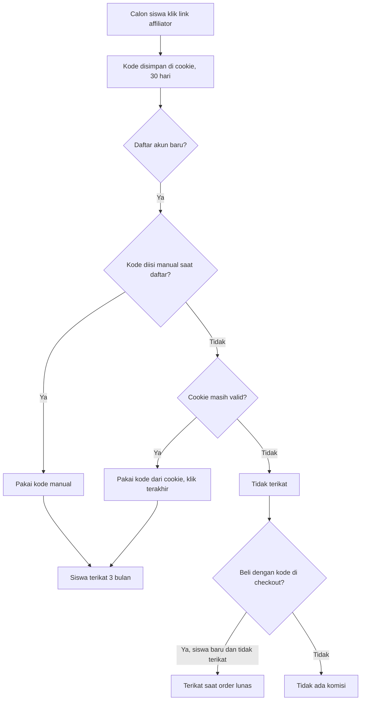
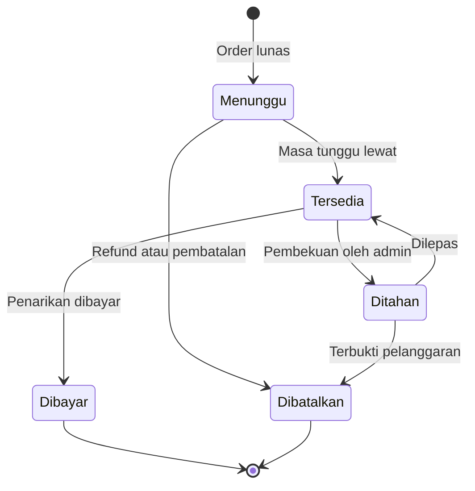

# Business Requirements Document (BRD)

## Fitur Affiliator (Affiliate Klasik)

| Item | Keterangan |
|---|---|
| Versi | 0.3 (Draft) |
| Tanggal | 25 Oktober 2026 |
| Status | Draft, untuk dilanjutkan ke PRD dan TRD serta bahan presentasi ke pengguna |
| Audiens | Tim internal (produk, engineering, operasional, keuangan) |
| Platform | Aplikasi web ujian online dan marketplace (Backend Golang, Frontend Next.js) |
| Persetujuan formal | Tidak diperlukan (dokumen internal) |
| Perubahan v0.2 | Fase 1 tanpa pajak, status penerimaan barang fisik sudah ada, admin adalah super admin. Q-02, Q-09, dan Q-13 dipindah ke daftar terjawab, Q-19 ditambahkan |
| Perubahan v0.3 | Order manual dihapus dari lingkup (BR-KOM-07 dan FR-KOM-06). Ambang persetujuan kedua penyesuaian nonaktif Fase 1 (satu akun super admin). Masa tunggu digital default 7 hari. Representasi uang mengikuti konvensi repo. A-04 dan A-10 terjawab; Q-08, Q-14, Q-15, dan Q-19 pindah ke daftar terjawab. TRD: `docs/specs/affiliate-program.md` |

---

## Daftar Isi

1. Ringkasan Eksekutif
2. Latar Belakang dan Masalah
3. Tujuan Bisnis dan Indikator Keberhasilan
4. Ruang Lingkup
5. Aktor dan Peran
6. Glosarium
7. Gambaran Proses Bisnis
8. Aturan Bisnis
9. Kebutuhan Fungsional
10. Parameter yang Diatur Admin
11. Kebutuhan Non-Fungsional
12. Asumsi
13. Risiko dan Mitigasi
14. Dependensi
15. Pertanyaan Terbuka
16. Lampiran

---

## 1. Ringkasan Eksekutif

Platform kami (ujian online dan marketplace buku, merchandise, medali, kursus, dan ujian) akan menambahkan peran baru **Affiliator**. Affiliator adalah individu yang mengajak calon siswa mendaftar melalui **link atau kode referral**. Siswa yang mendaftar lewat referral **terikat ke affiliator selama jangka waktu tertentu**, dan setiap pembelian siswa selama ikatan aktif menghasilkan **komisi uang** bagi affiliator.

Komisi melewati masa tunggu (untuk mengantisipasi refund), masuk ke saldo, lalu dicairkan ke rekening bank affiliator secara manual oleh admin. Affiliator dikelompokkan dalam **level (Bronze, Silver, Gold)** yang dievaluasi setiap kuartal. Admin mengatur seluruh angka aturan lewat halaman pengaturan, dan tersedia mekanisme **penyesuaian manual** serta **sanksi pelanggaran**.

Model yang dipakai adalah **affiliate klasik**. Fitur "agen" (affiliator mengelola siswa, mendaftarkan ujian untuk siswa, dan membeli atas nama siswa) **tidak termasuk** dalam BRD ini.

## 2. Latar Belakang dan Masalah

- Lembaga pendidikan (kursus) membutuhkan saluran akuisisi siswa baru di luar upaya internal.
- Saat ini tidak ada mekanisme resmi untuk memberi imbalan kepada pihak yang mengajak calon siswa (guru, alumni, orang tua, influencer, mitra).
- Tanpa pencatatan yang jelas, rekomendasi dari mulut ke mulut tidak terukur dan tidak bisa diberi imbalan secara adil.
- Marketplace sudah memiliki beragam produk (buku, merchandise, medali, kursus, ujian) sehingga ada potensi penjualan berulang dari siswa yang diajak.

## 3. Tujuan Bisnis dan Indikator Keberhasilan

### 3.1 Tujuan

| ID | Tujuan |
|---|---|
| G-01 | Menambah jumlah siswa baru melalui jalur referral |
| G-02 | Meningkatkan omzet marketplace dari siswa yang dibawa affiliator |
| G-03 | Menyediakan imbalan yang adil, transparan, dan terkendali biayanya |
| G-04 | Menjaga integritas keuangan dan mencegah penyalahgunaan program |

### 3.2 Indikator Keberhasilan (KPI)

Target angka **belum ditentukan** (lihat bagian 15). Indikator yang akan diukur:

| KPI | Definisi |
|---|---|
| Jumlah affiliator aktif | Affiliator yang menghasilkan minimal satu siswa baru atau satu transaksi dalam kuartal |
| Siswa baru dari affiliator | Siswa yang terikat lewat link atau kode |
| Omzet dari siswa binaan | Total nilai bersih transaksi siswa dengan ikatan aktif |
| Rasio konversi | Pendaftaran dibanding klik link |
| Biaya komisi terhadap omzet | Total komisi dibanding omzet binaan |
| Tingkat refund siswa binaan | Dibanding rata-rata platform |
| Jumlah kasus pelanggaran | Per kuartal |

## 4. Ruang Lingkup

### 4.1 Dalam Lingkup (Fase 1)

- Peran Affiliator, pendaftaran mandiri, dan persetujuan admin
- Kode dan link referral, pelacakan klik dasar
- Atribusi: pengikatan siswa ke affiliator (link, cookie, kode manual, kode di checkout)
- Komisi per kategori produk, masa tunggu, ledger, saldo
- Pencairan komisi ke rekening bank (manual oleh admin)
- Level affiliator (Bronze, Silver, Gold) dengan evaluasi per kuartal
- Halaman pengaturan admin (aturan global dan aturan per level)
- Dashboard Affiliator dan tambahan di dashboard Admin
- Penyesuaian komisi manual (kasus pembayaran offline dicatat sebagai penyesuaian, bukan order)
- Sistem pelanggaran dasar: status akun, pembekuan saldo, catatan pelanggaran, penurunan atau penguncian level, banding
- Penandaan kasus mencurigakan berbasis aturan sederhana (hanya menandai, tidak menjatuhkan sanksi otomatis)
- Laporan dan audit log

### 4.2 Di Luar Lingkup

| Item | Keterangan |
|---|---|
| Fitur agen (kelola siswa, daftarkan ujian untuk siswa, beli atas nama siswa) | Direncanakan terpisah, setelah fitur ini berjalan |
| Order manual (admin membuat order atas nama siswa untuk pembayaran offline) | Dihapus dari lingkup (v0.3). Komisi atas pembayaran offline memakai penyesuaian manual (FR-ADJ). Pendaftaran siswa langsung oleh admin tetap tidak menciptakan ikatan (BR-ATR-13) |
| Otomatisasi payout (transfer bank otomatis) | Pencairan Fase 1 manual oleh admin |
| Bonus target | Aturan belum ditentukan (TBD), masuk fase berikutnya |
| Komisi bertingkat (multi-level) | Tidak dilakukan, hanya satu level: affiliator ke siswa |
| Reward untuk siswa (diskon atau kredit referral) | Tidak dibahas dalam BRD ini |
| Sistem poin atau loyalty | Tidak dipakai, reward utama adalah uang |
| Notifikasi otomatis | Fase 1 memakai fitur broadcast manual yang sudah ada |
| Aturan khusus per affiliator (pengecualian di luar level) | Fase berikutnya, struktur data tetap disiapkan |
| Perhitungan, pemotongan, atau pelaporan pajak | Tidak ditangani sistem pada Fase 1 (keputusan: tanpa pajak dulu). Ditinjau ulang sebelum Fase 2 |

## 5. Aktor dan Peran

| Aktor | Deskripsi | Hak utama dalam fitur ini |
|---|---|---|
| **Affiliator** | Individu (guru, alumni, orang tua, influencer) yang mendaftar dan disetujui admin | Melihat kode dan link, siswa binaan (data terbatas), komisi, saldo, level, mengajukan penarikan, mengajukan banding |
| **Admin** | Pengelola platform. Admin memiliki wewenang penuh, tidak ada role Super Admin yang terpisah | Menyetujui affiliator, mengatur aturan, memproses penarikan, membuat penyesuaian manual, menjatuhkan sanksi, melihat laporan |
| **Siswa / calon siswa** | Pengguna yang mendaftar dan membeli | Tidak melihat apa pun terkait affiliator, hanya mendaftar lewat link atau kode dan membeli seperti biasa |
| **Admin sekolah** | Pengelola siswa di sebuah sekolah | Tidak punya akses ke fitur ini, dan tidak boleh menjadi affiliator |
| **Sistem** | Job dan layanan otomatis | Menghitung komisi, mengubah status, mengevaluasi level, menandai kasus mencurigakan |

## 6. Glosarium

| Istilah | Arti |
|---|---|
| Affiliator | Mitra yang mengajak calon siswa lewat link atau kode referral |
| Kode referral | Kode unik milik affiliator |
| Link referral | URL berisi kode referral |
| Cookie | Penyimpanan sementara di browser calon siswa yang mengingat kode referral dari klik link sampai ia mendaftar |
| Ikatan | Hubungan siswa dan affiliator yang menentukan siapa menerima komisi |
| Komisi | Imbalan uang atas pembelian siswa binaan |
| Masa tunggu | Jeda sebelum komisi bisa ditarik, untuk mengantisipasi refund |
| Ledger | Catatan mutasi saldo yang hanya bisa ditambah (append-only) |
| Level | Tingkatan affiliator (Bronze, Silver, Gold) |
| Kuartal | Periode 3 bulan kalender: Jan-Mar, Apr-Jun, Jul-Sep, Okt-Des |
| Omzet bersih | Nilai item setelah diskon, tanpa ongkir, pajak, dan biaya payment gateway |
| Transaksi final | Transaksi lunas yang sudah melewati masa tunggu dan tidak direfund |
| Penyesuaian manual | Penambahan atau pengurangan saldo affiliator oleh admin dengan alasan tercatat |
| Snapshot | Salinan nilai aturan yang berlaku saat transaksi, disimpan di record komisi |

## 7. Gambaran Proses Bisnis

### 7.1 Alur End-to-End

1. Calon affiliator mendaftar mandiri, admin menyetujui, affiliator mendapat kode dan link.
2. Affiliator membagikan link atau kode ke calon siswa.
3. Calon siswa mendaftar. Sistem mengikat siswa ke affiliator (lewat cookie atau kode yang diisi) dan memulai ikatan 3 bulan.
4. Siswa membeli produk di marketplace. Setelah pembayaran lunas, sistem membuat komisi berstatus **Menunggu**.
5. Setiap pembelian siswa yang memenuhi nilai minimum memperpanjang ikatan 3 bulan.
6. Setelah masa tunggu lewat tanpa refund, komisi menjadi **Tersedia** dan masuk saldo.
7. Affiliator mengajukan penarikan saat saldo mencapai minimum. Admin mentransfer manual pada jadwal pencairan, lalu menandai **Dibayar**.
8. Setiap kuartal, sistem mengevaluasi level affiliator berdasarkan omzet bersih siswa binaan.

### 7.2 Alur Atribusi

### 7.3 Status Komisi

Refund setelah komisi berstatus Dibayar ditangani dengan entri pengurang di ledger (lihat BR-KOM-11), bukan mengubah status lama.

---

## 8. Aturan Bisnis

### 8.1 Registrasi dan Akun Affiliator (BR-REG)

| ID | Aturan |
|---|---|
| BR-REG-01 | Calon affiliator mendaftar mandiri. Akun berstatus **Menunggu Persetujuan** dan belum memiliki kode aktif. |
| BR-REG-02 | Admin menyetujui atau menolak pendaftaran. Penolakan wajib mencatat alasan. |
| BR-REG-03 | Satu akun terkait satu email dan satu peran. Orang yang sama boleh memiliki akun siswa dan akun affiliator dengan email berbeda. Admin sekolah tidak boleh menjadi affiliator. |
| BR-REG-04 | Affiliator wajib menyetujui Ketentuan Program saat mendaftar. Versi ketentuan dan waktu persetujuan dicatat. |
| BR-REG-05 | Affiliator yang disetujui mendapat kode referral unik dan link referral. |
| BR-REG-06 | Data pencairan (bank, nomor rekening, nama pemilik rekening) wajib diisi sebelum penarikan. Setiap perubahan rekening dicatat di audit log. |
| BR-REG-07 | Status akun affiliator: Menunggu Persetujuan, Aktif, Ditangguhkan, Nonaktif, Ditolak. |

### 8.2 Atribusi dan Ikatan (BR-ATR)

| ID | Aturan |
|---|---|
| BR-ATR-01 | Mengklik link referral menyimpan kode di cookie selama masa berlaku yang diatur admin (default 30 hari). Cookie hanya menjembatani jarak antara klik dan pendaftaran. |
| BR-ATR-02 | Saat siswa baru mendaftar, siswa terikat ke affiliator jika ada kode yang diisi manual atau cookie yang masih valid. Jika keduanya ada dan berbeda, **kode manual didahulukan** (asumsi A-03). |
| BR-ATR-03 | Jika sebelum mendaftar calon siswa mengklik link beberapa affiliator berbeda, yang berlaku adalah **klik terakhir** (asumsi A-02). |
| BR-ATR-04 | Satu siswa hanya terikat ke satu affiliator pada satu waktu. Selama ikatan aktif, klik link atau kode affiliator lain tidak mengubah ikatan. |
| BR-ATR-05 | **Kode di checkout** hanya dapat dipakai siswa yang saat ini tidak terikat dan terdaftar setelah tanggal peluncuran. Ikatan dan komisi terjadi ketika order tersebut berstatus lunas. |
| BR-ATR-06 | Akun yang terdaftar sebelum tanggal peluncuran fitur **tidak dapat diikat** ke affiliator. |
| BR-ATR-07 | Durasi ikatan default **3 bulan** sejak ikatan dibuat. Setiap pembelian lunas dengan nilai bersih minimal sebesar nilai yang diatur admin memperpanjang ikatan 3 bulan terhitung dari tanggal pembayaran. **Tidak ada batas maksimal** total durasi. |
| BR-ATR-08 | Setelah ikatan berakhir, siswa bebas. Riwayat ikatan **tidak mengunci**: affiliator mana pun, termasuk affiliator sebelumnya, dapat mengikatnya kembali lewat kode di checkout (selama memenuhi BR-ATR-05). |
| BR-ATR-09 | Komisi tidak diberikan atas pembelian milik affiliator sendiri. Sistem menolak pemakaian kode sendiri dan menandai kasus bila terdeteksi akun yang sama (email atau nomor HP identik). |
| BR-ATR-10 | Perubahan durasi ikatan oleh admin hanya berlaku untuk ikatan yang dibuat atau diperpanjang setelah perubahan. |
| BR-ATR-11 | Ikatan tidak pernah dihapus. Statusnya Aktif atau Berakhir, lengkap dengan tanggal mulai, tanggal berakhir, dan sumber (link, kode manual, kode checkout). |
| BR-ATR-12 | Jika akun affiliator berstatus Ditangguhkan atau Nonaktif, komisi baru tidak dibuat. Siswa tidak dialihkan otomatis ke affiliator lain (asumsi A-06). |
| BR-ATR-13 | Pendaftaran siswa langsung oleh admin (tanpa order) tidak menciptakan ikatan dan tidak menghasilkan komisi. |

### 8.3 Komisi (BR-KOM)

| ID | Aturan |
|---|---|
| BR-KOM-01 | Komisi hanya lahir dari **order berstatus lunas** di marketplace, untuk siswa yang ikatannya aktif pada tanggal pembayaran. |
| BR-KOM-02 | Kategori produk: Buku, Merchandise, Medali, Kursus, Ujian. Persentase komisi diatur admin per kategori, dengan kemungkinan pengecualian per produk. Persentase 0% berarti tidak ada komisi. |
| BR-KOM-03 | Dasar perhitungan adalah **harga item setelah diskon**, tidak termasuk ongkir, pajak, dan biaya payment gateway. Item gratis atau yang dibayar penuh dengan voucher tidak menghasilkan komisi. |
| BR-KOM-04 | Semua pembelian selama ikatan aktif dikomisi. Tidak ada komisi khusus pembelian pertama. |
| BR-KOM-05 | Komisi dihitung per item order. Setiap record komisi menyimpan **snapshot** persentase, level affiliator, dan dasar perhitungan. Perubahan aturan tidak mengubah komisi yang sudah tercatat. |
| BR-KOM-06 | Pendaftaran langsung oleh admin tanpa pembayaran tidak menghasilkan komisi. Pembayaran offline yang perlu dikomisi dicatat admin sebagai penyesuaian manual (FR-ADJ), bukan order. |
| BR-KOM-08 | Status komisi: **Menunggu**, **Tersedia**, **Dibayar**, **Dibatalkan**, **Ditahan**. |
| BR-KOM-09 | Masa tunggu (diatur admin): produk digital (Ujian, Kursus) **7 hari** setelah pembayaran. Produk fisik (Buku, Merchandise, Medali) **7 hari setelah barang diterima ditambah 7 hari**. Nilai 0 berarti komisi langsung Tersedia. |
| BR-KOM-10 | Setelah masa tunggu lewat dan tidak ada refund, komisi otomatis menjadi Tersedia dan masuk saldo. |
| BR-KOM-11 | **Refund atau pembatalan**: bila komisi masih Menunggu, komisi dibatalkan. Bila sudah Tersedia atau Dibayar, sistem membuat entri pengurang di ledger. Saldo boleh bernilai negatif sementara dan ditutup oleh komisi berikutnya. Refund sebagian mengurangi komisi secara proporsional. |
| BR-KOM-12 | Seluruh perubahan saldo dicatat di **ledger append-only**. Entri lama tidak diedit atau dihapus. Koreksi dilakukan dengan entri baru. |
| BR-KOM-13 | Pembuatan komisi harus **idempoten**: satu item order hanya menghasilkan satu komisi walaupun event pembayaran diterima berulang. |

### 8.4 Level (BR-LVL)

| ID | Aturan |
|---|---|
| BR-LVL-01 | Level: **Bronze**, **Silver**, **Gold**. Affiliator baru mulai dari Bronze. |
| BR-LVL-02 | Evaluasi dilakukan per **kuartal kalender** (zona waktu WIB), berdasarkan **omzet bersih transaksi final** siswa binaan pada kuartal tersebut. |
| BR-LVL-03 | Evaluasi dijalankan setelah kuartal berakhir dengan jeda finalisasi transaksi (default hari ke-8 bulan pertama kuartal baru, diatur admin). Level baru berlaku untuk transaksi setelah evaluasi selesai. |
| BR-LVL-04 | **Naik**: omzet mencapai ambang naik level yang lebih tinggi. Kenaikan boleh melompat lebih dari satu tingkat. |
| BR-LVL-05 | **Bertahan**: omzet mencapai ambang bertahan (boleh lebih rendah dari ambang naik). **Turun** satu tingkat jika ambang bertahan tidak tercapai **dua kuartal berturut-turut**. Pada kuartal pertama yang tidak tercapai, affiliator hanya mendapat peringatan di dashboard. |
| BR-LVL-06 | Affiliator baru dievaluasi pertama kali pada akhir kuartal berikutnya setelah bergabung (asumsi A-09). |
| BR-LVL-07 | Transaksi yang terbukti curang atau direfund dikeluarkan dari perhitungan omzet level. Penyesuaian manual kategori bonus, kompensasi, atau pelanggaran tidak dihitung ke omzet level. |
| BR-LVL-08 | Hal yang dapat dibedakan per level: persentase komisi per kategori, durasi ikatan, kecepatan pencairan (masa tunggu dan jadwal), dan minimal penarikan. Nilai level yang kosong mengikuti aturan global. Nilai awal boleh sama di semua level. |
| BR-LVL-09 | Admin dapat mengubah level secara manual atau **mengunci level** sampai tanggal tertentu, dengan alasan wajib. Level terkunci tidak diubah oleh evaluasi otomatis. |
| BR-LVL-10 | Setiap perubahan level tercatat di riwayat: level lama, level baru, kuartal, omzet yang dipakai, sumber (otomatis atau manual), dan alasan. |
| BR-LVL-11 | Level yang berlaku pada saat transaksi atau perpanjangan ikatan disimpan sebagai snapshot dan tidak diubah mundur. |

### 8.5 Pencairan (BR-PCR)

| ID | Aturan |
|---|---|
| BR-PCR-01 | **Saldo tersedia** = komisi Tersedia + penyesuaian penambah − pengurang − penarikan yang diajukan atau dibayar. Saldo yang dibekukan tidak dapat ditarik. |
| BR-PCR-02 | Penarikan diajukan oleh affiliator jika saldo tersedia mencapai minimal penarikan (default Rp100.000). |
| BR-PCR-03 | Pencairan dilakukan **manual oleh admin lewat transfer bank** pada jadwal pencairan (default sekali sebulan). Admin menandai penarikan Dibayar dan melampirkan bukti transfer. |
| BR-PCR-04 | Status penarikan: Diajukan, Diproses, Dibayar, Ditolak. Penolakan wajib mencatat alasan dan saldo dikembalikan. |
| BR-PCR-05 | Rekening tujuan harus atas nama affiliator (asumsi A-11). |
| BR-PCR-06 | **Fase 1 tanpa pajak**: sistem tidak menghitung, memotong, atau melaporkan pajak, dan tidak mengumpulkan data identitas atau pajak (KTP, NPWP). Nominal yang dibayar sama dengan nominal penarikan. Desain data tetap menyisakan ruang agar hal ini bisa ditambahkan kelak. Kewajiban pajak di luar sistem dikonfirmasi tim keuangan. |

### 8.6 Pelanggaran dan Sanksi (BR-PLG)

| ID | Aturan |
|---|---|
| BR-PLG-01 | Kebijakan pelanggaran dan sanksi dicantumkan di Ketentuan Program dan disetujui affiliator saat mendaftar. |
| BR-PLG-02 | Kategori pelanggaran: kecurangan transaksi (belanja sendiri, akun siswa palsu, pembelian kecil demi memperpanjang ikatan, order sengaja dibatalkan setelah komisi cair), penyalahgunaan data siswa, promosi menyesatkan (klaim palsu, mengaku pihak resmi), pelanggaran aturan program (spam, mengakali sistem), dan pelanggaran etika. |
| BR-PLG-03 | Sanksi bertingkat: (1) peringatan tercatat, (2) pengurangan atau pembatalan komisi terkait, (3) pembekuan saldo sementara, (4) penurunan atau penguncian level, (5) skors (status Ditangguhkan selama N hari), (6) penonaktifan permanen. |
| BR-PLG-04 | Sanksi diputuskan oleh **admin (manusia)** dengan alasan dan bukti tercatat. Deteksi otomatis hanya **menandai** kasus ke admin. |
| BR-PLG-05 | Pembekuan saldo memiliki batas waktu maksimal (default 14 hari, dapat diatur) dan harus disertai alasan. Selama dibekukan, komisi tidak dibatalkan sampai ada keputusan. |
| BR-PLG-06 | Affiliator berhak mengajukan **banding** dengan penjelasan atau bukti. Admin meninjau dan mencatat hasilnya. |
| BR-PLG-07 | Penonaktifan permanen membatalkan komisi berstatus Menunggu. Perlakuan saldo yang sudah Tersedia ditentukan kebijakan (TBD, bagian 15). |
| BR-PLG-08 | Aturan penandaan kasus mencurigakan (versi dasar): email atau nomor HP siswa identik dengan affiliator, lonjakan pendaftaran tidak wajar dalam waktu singkat, pembelian bernilai kecil berulang di sekitar batas perpanjangan ikatan, rasio refund tinggi pada siswa binaan, dan beberapa akun siswa dengan identitas kontak serupa. |

### 8.7 Penyesuaian Manual (BR-ADJ)

| ID | Aturan |
|---|---|
| BR-ADJ-01 | Admin dapat menambah atau mengurangi saldo affiliator dengan **kategori** (koreksi, offline, bonus, pelanggaran, lainnya), nominal, alasan wajib, dan catatan. |
| BR-ADJ-02 | Penyesuaian dicatat sebagai entri baru di ledger bertipe penyesuaian manual. Entri lama tidak diubah. |
| BR-ADJ-03 | Penyesuaian di atas ambang nominal (default Rp1.000.000, diatur admin) memerlukan **persetujuan admin lain** (akun admin berbeda dari pembuat penyesuaian). **Fase 1: aturan ini nonaktif** karena hanya ada satu akun super admin; struktur data penyesuaian tetap menyediakan status persetujuan sehingga aturan dapat diaktifkan saat akun admin kedua tersedia. |
| BR-ADJ-04 | Admin tidak boleh menyesuaikan saldo akun affiliator miliknya sendiri. |
| BR-ADJ-05 | Setiap penyesuaian terlihat oleh affiliator di riwayatnya beserta keterangan. |
| BR-ADJ-06 | Semua penyesuaian masuk audit log: siapa, kapan, nominal, kategori, alasan. |

### 8.8 Privasi dan Akses Data (BR-PRV)

| ID | Aturan |
|---|---|
| BR-PRV-01 | Affiliator hanya dapat melihat siswa yang terikat padanya. Pembatasan diterapkan di level query atau API, bukan hanya di tampilan. |
| BR-PRV-02 | Data siswa yang terlihat oleh affiliator: nama (bentuk lengkap atau inisial ditentukan di PRD), tanggal daftar, status dan tanggal berakhir ikatan, serta total belanja agregat. Affiliator **tidak** melihat email, nomor HP, alamat, atau nilai ujian. |
| BR-PRV-03 | Siswa tidak melihat status ikatan dan tidak menerima notifikasi terkait ikatan. Syarat dan Ketentuan atau Kebijakan Privasi platform memuat pernyataan bahwa pendaftaran lewat referral dapat dikaitkan dengan mitra yang mengajak. |
| BR-PRV-04 | Akses admin ke data affiliator dibatasi berdasarkan role. Pengelolaan data pribadi mengacu pada ketentuan pelindungan data pribadi yang berlaku (UU PDP), dikonfirmasi bersama legal. |

### 8.9 Notifikasi (BR-NTF)

| ID | Aturan |
|---|---|
| BR-NTF-01 | Pada Fase 1, komunikasi ke affiliator (persetujuan, perubahan level, peringatan, sanksi, pengumuman) memakai fitur **broadcast manual** yang sudah ada. |
| BR-NTF-02 | Dashboard menampilkan status secara pasif (lencana status ikatan, progres level, peringatan), tanpa notifikasi otomatis. |

---

## 9. Kebutuhan Fungsional

Seluruh kebutuhan di bawah ini masuk **Fase 1** kecuali ditandai lain.

### 9.1 Registrasi dan Akun (FR-REG)

| ID | Kebutuhan | Fase |
|---|---|---|
| FR-REG-01 | Formulir pendaftaran affiliator (data diri, email, nomor HP, persetujuan Ketentuan Program) | 1 |
| FR-REG-02 | Halaman antrean persetujuan untuk admin (setujui, tolak dengan alasan) | 1 |
| FR-REG-03 | Pembuatan kode dan link referral unik setelah disetujui | 1 |
| FR-REG-04 | Form data rekening bank affiliator beserta riwayat perubahannya | 1 |
| FR-REG-05 | Halaman Ketentuan Program yang dapat dibaca affiliator | 1 |

### 9.2 Referral dan Atribusi (FR-ATR)

| ID | Kebutuhan | Fase |
|---|---|---|
| FR-ATR-01 | Halaman penangkap link referral yang menyimpan kode di cookie | 1 |
| FR-ATR-02 | Kolom kode referral opsional pada form pendaftaran siswa | 1 |
| FR-ATR-03 | Kolom kode referral pada checkout untuk siswa yang memenuhi BR-ATR-05 | 1 |
| FR-ATR-04 | Pembuatan, perpanjangan, dan pengakhiran ikatan sesuai aturan BR-ATR | 1 |
| FR-ATR-05 | Pencatatan klik link dan pendaftaran dari link (statistik dasar) | 1 |
| FR-ATR-06 | Job harian yang menandai ikatan Berakhir | 1 |
| FR-ATR-07 | Pemblokiran pemakaian kode sendiri dan penandaan kasus akun serupa | 1 |

### 9.3 Komisi dan Ledger (FR-KOM)

| ID | Kebutuhan | Fase |
|---|---|---|
| FR-KOM-01 | Pembuatan komisi otomatis setelah order lunas (event atau job, idempoten) | 1 |
| FR-KOM-02 | Penyimpanan snapshot persentase, level, dan dasar perhitungan per record komisi | 1 |
| FR-KOM-03 | Transisi status komisi otomatis (Menunggu ke Tersedia) setelah masa tunggu | 1 |
| FR-KOM-04 | Pembatalan atau pengurangan komisi otomatis saat refund atau pembatalan order | 1 |
| FR-KOM-05 | Ledger append-only dan perhitungan saldo dari ledger | 1 |

### 9.4 Dashboard Affiliator (FR-DSH)

| ID | Kebutuhan | Fase |
|---|---|---|
| FR-DSH-01 | Ringkasan: jumlah siswa terikat aktif, omzet binaan, komisi Menunggu, Tersedia, Dibayar, saldo | 1 |
| FR-DSH-02 | Kode dan link referral dengan tombol salin | 1 |
| FR-DSH-03 | Daftar siswa binaan (data terbatas sesuai BR-PRV-02) dengan status ikatan: Aktif, Segera Berakhir, Berakhir | 1 |
| FR-DSH-04 | Riwayat komisi dengan filter status, periode, dan kategori | 1 |
| FR-DSH-05 | Level saat ini, progres omzet kuartal berjalan terhadap ambang naik dan ambang bertahan, serta peringatan | 1 |
| FR-DSH-06 | Pengajuan dan riwayat penarikan | 1 |
| FR-DSH-07 | Riwayat penyesuaian manual, peringatan, dan sanksi beserta alasan | 1 |
| FR-DSH-08 | Statistik klik dan pendaftaran dari link | 1 |
| FR-DSH-09 | Formulir banding | 1 |

### 9.5 Pencairan (FR-PCR)

| ID | Kebutuhan | Fase |
|---|---|---|
| FR-PCR-01 | Pengajuan penarikan dengan validasi saldo dan minimal penarikan | 1 |
| FR-PCR-02 | Antrean penarikan untuk admin, ekspor daftar untuk transfer manual | 1 |
| FR-PCR-03 | Penandaan Dibayar dengan unggah bukti transfer, atau penolakan dengan alasan | 1 |

### 9.6 Level (FR-LVL)

| ID | Kebutuhan | Fase |
|---|---|---|
| FR-LVL-01 | Job evaluasi level per kuartal, idempoten dan dapat dijalankan ulang oleh admin | 1 |
| FR-LVL-02 | Penyimpanan riwayat level per affiliator | 1 |
| FR-LVL-03 | Ubah level manual dan kunci level sampai tanggal tertentu dengan alasan wajib | 1 |
| FR-LVL-04 | Pengambilan nilai aturan efektif: level lalu global (aturan khusus per affiliator ditambahkan Fase 2) | 1 |

### 9.7 Pengaturan Admin (FR-SET)

| ID | Kebutuhan | Fase |
|---|---|---|
| FR-SET-01 | Halaman pengaturan aturan global (lihat bagian 10) | 1 |
| FR-SET-02 | Halaman pengaturan aturan per level, nilai kosong berarti ikut global | 1 |
| FR-SET-03 | Pengecualian komisi per produk | 1 |
| FR-SET-04 | Riwayat perubahan pengaturan (siapa, kapan, nilai lama, nilai baru) | 1 |
| FR-SET-05 | Perubahan pengaturan tidak berlaku mundur ke data historis | 1 |

### 9.8 Manajemen Affiliator oleh Admin (FR-ADM)

| ID | Kebutuhan | Fase |
|---|---|---|
| FR-ADM-01 | Daftar affiliator dengan filter status dan level | 1 |
| FR-ADM-02 | Halaman detail affiliator: profil, siswa binaan, komisi, saldo, riwayat level, catatan pelanggaran | 1 |
| FR-ADM-03 | Ubah status akun (Aktif, Ditangguhkan, Nonaktif) dengan alasan | 1 |
| FR-ADM-04 | Pembekuan dan pelepasan saldo dengan alasan dan batas waktu | 1 |
| FR-ADM-05 | Pencatatan peringatan dan sanksi (catatan pelanggaran) | 1 |
| FR-ADM-06 | Antrean banding dan pencatatan keputusan | 1 |
| FR-ADM-07 | Daftar kasus yang ditandai mencurigakan beserta statusnya (ditinjau, valid, diabaikan) | 1 |

### 9.9 Penyesuaian Manual (FR-ADJ)

| ID | Kebutuhan | Fase |
|---|---|---|
| FR-ADJ-01 | Formulir penyesuaian: affiliator, kategori, nominal (+ atau −), alasan, catatan | 1 |
| FR-ADJ-02 | Alur persetujuan admin kedua untuk nominal di atas ambang (struktur data disiapkan; alur dibangun saat ada akun admin kedua) | 2 |
| FR-ADJ-03 | Pencegahan penyesuaian ke akun milik admin yang sama | 1 |

### 9.10 Laporan dan Audit (FR-RPT)

| ID | Kebutuhan | Fase |
|---|---|---|
| FR-RPT-01 | Laporan komisi per periode, per affiliator, per kategori | 1 |
| FR-RPT-02 | Laporan liabilitas: total saldo Tersedia dan Menunggu yang belum dibayar | 1 |
| FR-RPT-03 | Laporan kinerja affiliator (siswa baru, omzet, konversi) | 1 |
| FR-RPT-04 | Audit log yang dapat dicari dan tidak dapat diubah | 1 |

### 9.11 Notifikasi (FR-NTF)

| ID | Kebutuhan | Fase |
|---|---|---|
| FR-NTF-01 | Fitur broadcast manual yang ada dapat menargetkan role Affiliator | 1 |
| FR-NTF-02 | Notifikasi otomatis (email dan in-app) untuk kejadian penting | 2 |

---

## 10. Parameter yang Diatur Admin

Status: **Disepakati** (sudah diputuskan), **Placeholder** (nilai awal sementara, bisa diubah admin), **TBD** (belum ditentukan).

| Parameter | Nilai Awal | Level | Status |
|---|---|---|---|
| Durasi ikatan | 3 bulan | Global dan per level | Disepakati |
| Minimal nilai bersih pembelian untuk perpanjang ikatan | Belum ada | Global | TBD |
| Masa berlaku cookie | 30 hari | Global | Disepakati |
| Persentase komisi per kategori (Ujian, Kursus, Buku, Merchandise, Medali) | Ujian 10%, Kursus 10%, Buku 3%, Merchandise 3%, Medali 0% | Global dan per level | Placeholder |
| Pengecualian komisi per produk | Kosong | Per produk | Disepakati |
| Masa tunggu produk digital | 7 hari setelah pembayaran | Global dan per level | Disepakati |
| Masa tunggu produk fisik | 7 hari setelah diterima, ditambah 7 hari | Global dan per level | Disepakati |
| Minimal penarikan | Rp100.000 | Global dan per level | Disepakati |
| Jadwal pencairan | Sekali sebulan, tanggal belum ditentukan | Global dan per level | Disepakati (tanggal TBD) |
| Ambang naik ke Silver | Rp5.000.000 per kuartal | Global | Placeholder |
| Ambang naik ke Gold | Rp15.000.000 per kuartal | Global | Placeholder |
| Ambang bertahan per level | Belum ada (tidak lebih tinggi dari ambang naik) | Global | TBD |
| Jumlah kuartal berturut-turut sebelum turun level | 2 | Global | Disepakati |
| Hari evaluasi level setelah kuartal berakhir | Hari ke-8 bulan pertama kuartal baru | Global | Placeholder |
| Ambang nominal penyesuaian yang butuh persetujuan kedua | Rp1.000.000 | Global | Disepakati (nonaktif Fase 1, lihat BR-ADJ-03) |
| Batas maksimal pembekuan saldo | 14 hari | Global | Placeholder |
| Batas hari sebelum ikatan berakhir untuk status Segera Berakhir | 30 hari | Global | Placeholder |
| Tanggal peluncuran (batas akun lama tidak bisa diikat) | Belum ada | Global | TBD |
| Batas pendaftaran siswa baru per affiliator per hari | Belum ada | Global | TBD |

---

## 11. Kebutuhan Non-Fungsional

| ID | Kategori | Kebutuhan |
|---|---|---|
| NFR-01 | Keamanan akses | Otorisasi berbasis role. Data siswa dan komisi dibatasi per affiliator di level query atau API. Affiliator tidak dapat mengakses data affiliator lain. |
| NFR-02 | Integritas keuangan | Ledger append-only, saldo dapat direkonsiliasi dari jumlah ledger. Representasi uang mengikuti konvensi repo: `NUMERIC(12,2)` di database dan `float64` di aplikasi; nominal komisi dibulatkan ke rupiah utuh saat dibuat. |
| NFR-03 | Idempotensi | Pembuatan komisi, evaluasi level, dan transisi status aman dijalankan ulang tanpa menghasilkan data ganda. |
| NFR-04 | Pemisahan beban | Perhitungan komisi berjalan asinkron setelah pembayaran sukses (event atau job), tidak memperlambat atau menggagalkan checkout. Kegagalan harus dapat diulang. |
| NFR-05 | Audit | Perubahan aturan, level, status akun, penyesuaian, penarikan, dan sanksi tercatat (siapa, kapan, sebelum, sesudah, alasan) dan tidak dapat diubah. |
| NFR-06 | Job terjadwal | Job harian dan kuartalan berjalan di zona waktu Asia/Jakarta, dapat dijalankan ulang secara manual oleh admin, dan menghasilkan log hasil. |
| NFR-07 | Anti-penyalahgunaan | Pembatasan laju (rate limiting) pada endpoint klik, pendaftaran, dan penerapan kode. Kode referral tidak mudah ditebak. |
| NFR-08 | Kinerja | Daftar dan laporan memakai paginasi. Target waktu respons ditetapkan di PRD dan TRD. |
| NFR-09 | Privasi | Minimalisasi data yang ditampilkan ke affiliator. Kebijakan retensi data ditetapkan bersama legal (TBD). |
| NFR-10 | Kompatibilitas | Alur checkout yang ada hanya ditambah penangkapan kode. Fitur dapat dimatikan melalui feature flag tanpa memengaruhi transaksi normal. |
| NFR-11 | Pengamatan | Log dan metrik untuk pembuatan komisi, kegagalan job, dan antrean penarikan. |
| NFR-12 | UX dan lokalisasi | Antarmuka responsif (mobile dan desktop), Bahasa Indonesia, mata uang Rupiah, waktu WIB. |

---

## 12. Asumsi

| ID | Asumsi |
|---|---|
| A-01 | Order marketplace memiliki status lunas dan refund atau batal, serta item per kategori dengan harga setelah diskon yang dapat dialokasikan per item. |
| A-02 | Jika calon siswa mengklik beberapa link sebelum mendaftar, **klik terakhir** yang dipakai. |
| A-03 | Kode yang diisi manual saat pendaftaran didahulukan dibanding cookie. |
| A-04 | Sistem sudah memiliki status penerimaan barang fisik. Tanggal "diterima" yang dipakai adalah `completed_at` order (admin menandai order selesai); status `delivered` dari kurir dipakai sebagai fallback bila tersedia. Detail diverifikasi di TRD. |
| A-05 | Klik link pada akun yang sudah terikat aktif diabaikan, dan klik setelah ikatan berakhir hanya menjadi cookie untuk dipakai di checkout bila siswa memenuhi BR-ATR-05. |
| A-06 | Affiliator Ditangguhkan atau Nonaktif tidak menghasilkan komisi baru, dan siswa tidak dialihkan otomatis. |
| A-07 | Order manual tidak dibangun. Pembayaran offline yang perlu dikomisi dicatat admin sebagai penyesuaian manual dengan alasan dan audit. |
| A-08 | Seluruh perhitungan periode memakai zona waktu WIB. |
| A-09 | Evaluasi level pertama untuk affiliator baru dilakukan di akhir kuartal berikutnya. |
| A-10 | Fitur broadcast manual yang ada dapat menargetkan pengguna berdasarkan role, dengan menambahkan grup penerima `affiliators` (grup saat ini hanya all, students, admins). |
| A-11 | Rekening pencairan harus atas nama affiliator. |
| A-12 | Ketentuan Program dan teks privasi disusun bersama bisnis dan legal. |
| A-13 | Perubahan aturan tidak berlaku mundur, dan durasi ikatan baru berlaku untuk ikatan baru. |
| A-14 | Sistem pembayaran yang ada dapat memberi sinyal (callback atau status) yang bisa dipakai memicu pembuatan komisi. |

## 13. Risiko dan Mitigasi

| Risiko | Dampak | Mitigasi |
|---|---|---|
| Belanja sendiri atau akun siswa palsu demi komisi | Kerugian biaya komisi | Larangan belanja sendiri, penandaan kasus otomatis, persetujuan admin untuk affiliator baru, sanksi |
| Pembelian kecil berulang untuk memperpanjang ikatan | Ikatan tidak pernah habis tanpa siswa aktif | Nilai minimal perpanjangan diatur admin, penandaan pola janggal |
| Refund setelah komisi dicairkan | Kerugian | Masa tunggu, entri pengurang di ledger, saldo boleh negatif |
| Persentase komisi melebihi margin produk | Penjualan merugi | Komisi per kategori dan per produk, tinjau margin sebelum menetapkan angka |
| Penyalahgunaan penyesuaian manual oleh admin | Kebocoran dana | Alasan wajib, audit log, larangan penyesuaian ke akun sendiri; persetujuan kedua disiapkan namun nonaktif Fase 1 |
| Sengketa antar-affiliator | Hubungan mitra rusak | Aturan jelas (satu siswa satu affiliator, klik terakhir, kode manual didahulukan), riwayat ikatan lengkap |
| Cookie hilang (ganti perangkat atau hapus data) | Affiliator kehilangan atribusi | Kode manual saat daftar dan di checkout sebagai cadangan |
| Pajak atas komisi tidak ditangani sistem pada Fase 1 | Risiko kepatuhan jika ternyata ada kewajiban | Keputusan: tanpa pajak dulu. Tim keuangan mengonfirmasi kewajiban di luar sistem, dan struktur data disiapkan agar pajak bisa ditambahkan |
| Hanya satu akun super admin yang mengelola fitur | Penyalahgunaan sulit dideteksi | Audit log, alasan wajib, laporan yang dapat direkonsiliasi; ambang persetujuan kedua siap diaktifkan saat akun admin kedua ada |
| Beban pencairan manual membesar | Admin kewalahan | Jadwal tetap sekali sebulan, ekspor daftar transfer, rencana otomatisasi payout di fase berikutnya |
| Kebocoran data siswa ke affiliator | Risiko privasi | Pembatasan data di API, tampilkan hanya data minimum |
| Dua keputusan bertabrakan pada affiliator yang berubah level di tengah periode | Perhitungan tidak konsisten | Snapshot level pada tiap komisi dan ikatan |

## 14. Dependensi

| Dependensi | Keterangan |
|---|---|
| Modul order dan pembayaran marketplace | Sumber event lunas, refund, dan item per kategori |
| Status penerimaan barang fisik | Diperlukan untuk masa tunggu produk fisik. Status sudah ada, detail diverifikasi di TRD |
| Modul pengguna dan role | Penambahan role Affiliator dan pembatasan akses |
| Fitur broadcast manual | Dipakai sebagai kanal komunikasi sementara |
| Tim keuangan | Proses transfer manual dan rekonsiliasi |
| Legal | Ketentuan Program, kebijakan privasi, pelindungan data pribadi |

---

## 15. Pertanyaan Terbuka

| No | Pertanyaan | Dampak | Usulan Pemilik |
|---|---|---|---|
| Q-01 | Target keberhasilan (siswa baru, persentase omzet) belum ditentukan | KPI dan evaluasi program | Pemilik bisnis |
| Q-03 | Nilai minimal pembelian untuk memperpanjang ikatan | Biaya komisi dan risiko akal-akalan. Diatur admin, tidak menghambat PRD dan TRD | Pemilik bisnis dan keuangan |
| Q-04 | Besaran final komisi per kategori (nilai saat ini placeholder) | Biaya dan daya tarik program. Diatur admin, tidak menghambat PRD dan TRD | Pemilik bisnis dan keuangan |
| Q-05 | Ambang naik dan ambang bertahan level (Silver dan Gold masih placeholder) | Distribusi level dan biaya | Pemilik bisnis |
| Q-06 | Detail bonus target | Fase berikutnya | Pemilik bisnis |
| Q-07 | Konfirmasi aturan atribusi: klik terakhir, kode manual didahulukan, perlakuan klik pada akun yang sudah terikat (A-02, A-03, A-05) | Aturan sengketa | Tim produk |
| Q-10 | Perlakuan saldo Tersedia saat affiliator dinonaktifkan permanen | Kebijakan sanksi | Pemilik bisnis dan legal |
| Q-11 | Siapa menanggung biaya transfer bank pencairan | Nominal diterima affiliator | Keuangan |
| Q-12 | Tanggal peluncuran (batas akun lama) dan tanggal pencairan bulanan | Operasional | Tim produk dan keuangan |
| Q-16 | Kebijakan retensi data affiliator dan siswa terkait fitur ini | Kepatuhan | Legal |
| Q-17 | Apakah Medali dikomisi (saat ini 0% sebagai placeholder) | Konfigurasi awal | Pemilik bisnis |
| Q-18 | Batas pendaftaran siswa baru per affiliator per hari | Pencegahan fraud | Tim produk |

### Sudah Terjawab (v0.2)

Nomor pertanyaan tidak diurut ulang agar referensi tetap konsisten.

| No | Pertanyaan | Jawaban |
|---|---|---|
| Q-02 | Kebijakan pajak dan data identitas affiliator | Fase 1 tanpa pajak (lihat BR-PCR-06) |
| Q-09 | Role Super Admin terpisah atau tidak | Tidak ada, admin adalah super admin (lihat BR-ADJ-03) |
| Q-13 | Apakah sistem mencatat penerimaan barang fisik | Status sudah ada, detail diverifikasi di TRD (lihat A-04) |

### Sudah Terjawab (v0.3)

| No | Pertanyaan | Jawaban |
|---|---|---|
| Q-08 | Apakah link bisa dipakai di checkout (bukan hanya kode) | Fase 1 hanya kode referral di checkout |
| Q-14 | Apakah broadcast manual bisa menargetkan role Affiliator | Ya, dengan menambahkan grup penerima `affiliators` pada fitur broadcast yang ada |
| Q-15 | Format nama siswa yang terlihat affiliator | Nama pertama + inisial |
| Q-19 | Berapa akun admin yang akan ada | Satu; ambang persetujuan kedua nonaktif Fase 1 (lihat BR-ADJ-03) |

---

## 16. Lampiran

### Lampiran A. Contoh Perhitungan

Asumsi nilai: komisi Ujian 10%, Buku 3%, minimal perpanjangan Rp25.000, masa tunggu digital 7 hari, masa tunggu fisik 7 + 7 hari (angka hanya ilustrasi).

| Tanggal | Kejadian | Hasil |
|---|---|---|
| 1 Jan | Ani mendaftar lewat link Pak Budi | Ikatan aktif sampai 1 Apr |
| 15 Jan | Ani membeli ujian Rp100.000 (lunas) | Komisi Rp10.000 berstatus Menunggu, ikatan diperpanjang sampai 15 Apr |
| 22 Jan | Masa tunggu 7 hari lewat | Komisi Rp10.000 menjadi Tersedia, saldo Rp10.000 |
| 1 Feb | Ani membeli buku Rp80.000 (lunas) | Komisi Rp2.400 berstatus Menunggu, ikatan diperpanjang sampai 1 Mei |
| 5 Feb | Buku diterima (order ditandai selesai admin) | Masa tunggu fisik mulai dihitung (7 + 7 hari) |
| 19 Feb | Masa tunggu lewat | Komisi Rp2.400 menjadi Tersedia, saldo Rp12.400 |
| 19 Feb | Pak Budi melihat saldo | Belum bisa menarik karena belum mencapai Rp100.000 |

Skenario refund: jika Ani direfund pada 10 Feb untuk ujian Rp100.000 setelah komisi Tersedia, sistem membuat entri pengurang Rp10.000 di ledger dan saldo menjadi Rp2.400.

### Lampiran B. Rencana Fase

| Fase | Isi |
|---|---|
| Fase 1 | Seluruh kebutuhan pada bagian 9 yang bertanda Fase 1 |
| Fase 2 (usulan) | Bonus target (setelah Q-06), otomatisasi payout, notifikasi otomatis, aturan khusus per affiliator, deteksi fraud lanjutan |
| Fase 3 / terpisah | Fitur agen: kelola siswa, daftarkan ujian untuk siswa, beli atas nama siswa |

### Lampiran C. Log Keputusan

| No | Keputusan |
|---|---|
| 1 | Model: affiliate klasik. Fitur agen dipisah. |
| 2 | Affiliator adalah individu |
| 3 | Pendaftaran mandiri dan persetujuan admin |
| 4 | Satu email satu peran, orang yang sama boleh punya akun siswa dan akun affiliator dengan email berbeda |
| 5 | Atribusi: link (cookie 30 hari) mengikat siswa, kode manual sebagai cadangan, kode di checkout untuk siswa baru yang tidak terikat |
| 6 | Durasi ikatan 3 bulan, diperpanjang saat pembelian bernilai minimal tertentu, tanpa batas maksimal |
| 7 | Akun sebelum peluncuran tidak bisa diklaim |
| 8 | Ikatan tidak mengunci setelah habis (opsi 1) |
| 9 | Satu siswa satu affiliator dan siswa terikat admin sekolah tetap boleh terikat affiliator |
| 10 | Semua pembelian selama ikatan aktif dikomisi |
| 11 | Komisi per kategori, diatur admin, dasar harga setelah diskon tanpa ongkir, pajak, dan biaya gateway |
| 12 | Tidak ada komisi dari belanja sendiri dan dari pendaftaran langsung oleh admin |
| 13 | Masa tunggu 7 + 7 hari (fisik), diatur admin |
| 14 | Order manual masuk Fase 1 (dicabut v0.3, lihat keputusan 27) |
| 15 | Level Bronze, Silver, Gold, evaluasi per kuartal kalender, turun satu tingkat setelah dua kuartal berturut-turut |
| 16 | Per level dapat dibedakan: komisi, durasi ikatan, kecepatan pencairan, minimal penarikan |
| 17 | Pencairan transfer bank manual, minimal Rp100.000, sekali sebulan |
| 18 | Refund setelah dibayar dipotong dari saldo berikutnya |
| 19 | Sanksi bertingkat dengan banding, penyesuaian manual dengan audit dan persetujuan kedua di atas ambang |
| 20 | Data siswa terbatas untuk affiliator |
| 21 | Notifikasi memakai broadcast manual yang ada |
| 22 | BRD berbahasa Indonesia, untuk tim internal, dilanjutkan ke PRD dan TRD |
| 23 | Fase 1 tanpa pajak: tidak ada perhitungan atau pengumpulan data pajak |
| 24 | Nilai minimal perpanjangan ikatan dan besaran komisi tetap diatur admin, angka final ditetapkan sebelum peluncuran |
| 25 | Status penerimaan barang fisik sudah ada di sistem, detail diverifikasi di TRD |
| 26 | Admin adalah super admin, tidak ada role terpisah, persetujuan kedua dilakukan akun admin lain |
| 27 | Order manual dihapus dari lingkup (v0.3); komisi atas pembayaran offline memakai penyesuaian manual |
| 28 | Hanya satu akun super admin; ambang persetujuan kedua nonaktif Fase 1, struktur data disiapkan untuk masa depan |
| 29 | Masa tunggu digital default 7 hari (diatur admin, boleh 0) |
| 30 | Uang mengikuti konvensi repo (NUMERIC(12,2) di DB, float64 di aplikasi); komisi dibulatkan ke rupiah utuh saat dibuat |
| 31 | Checkout hanya menerima kode referral, bukan link (Fase 1) |
| 32 | Nama siswa yang terlihat affiliator: nama pertama + inisial |
| 33 | Tanggal "barang diterima" = `completed_at` order; status delivered kurir sebagai fallback |
| 34 | Broadcast manual ditambahkan grup penerima `affiliators` |
| 35 | Pengelolaan fitur affiliator (persetujuan, pengaturan, penarikan, sanksi, penyesuaian) hanya oleh role super_admin |
