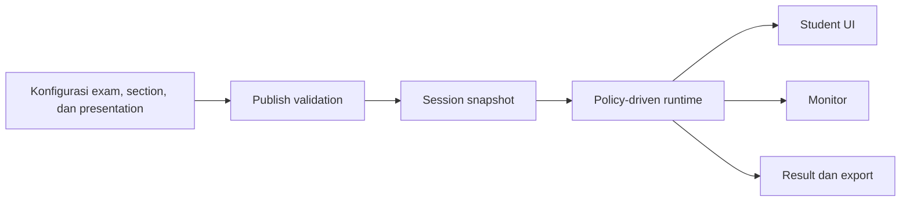
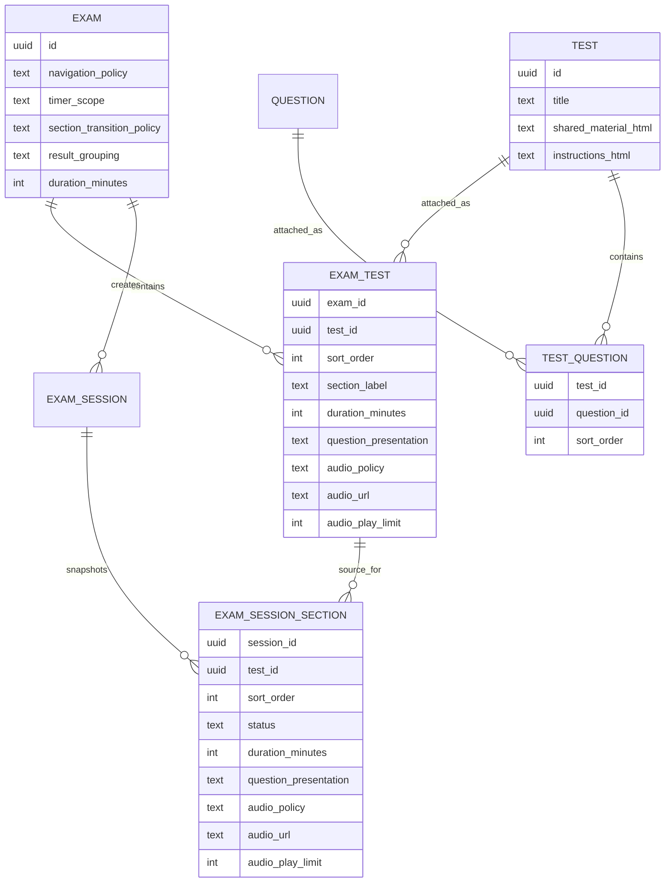
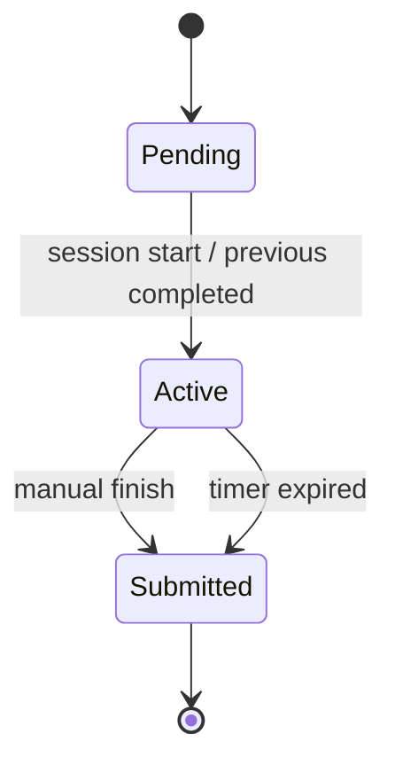

# Exam Format System Design

**Status:** Draft for review  
**Date:** 2026-09-23  
**Scope:** Redesign arsitektur format ujian; belum merupakan implementation plan final  
**Current baseline:** `main` @ `e6cf227c1e005e4ee35ba9850c65b0532268a749`  
**Backlog tracking:** GitHub issue [#185](https://github.com/abak-academy/platform/issues/185)

**Current-UI prototype:** `docs/prototypes/exam-format-user-flow-v2.html`  
Prototype v2 adalah review artifact utama. Prototype sebelumnya dipertahankan hanya sebagai eksplorasi north-star dan bukan implementation specification.

## 1. Ringkasan

Implementasi saat ini menjadikan `standard`, `utbk`, dan `ielts` sebagai mode runtime. Nama mode menentukan apakah ujian flat atau sectioned, bagaimana timer bekerja, dan bagaimana UI menampilkan soal.

Model tersebut terlalu kaku. Kebutuhan format baru akan terus menghasilkan percabangan seperti:

```text
if mode == "utbk" || mode == "ielts"
```

Proposal ini mengganti named mode dengan **composable exam format**:

- perilaku ujian ditentukan oleh policy eksplisit;
- perilaku section ditentukan oleh konfigurasi attachment antara Exam dan Test;
- tidak ada preset atau identifier Standard, UTBK, dan IELTS pada model baru;
- pola ujian yang biasa disebut Standard, UTBK, atau IELTS hanya menjadi contoh konfigurasi dan acceptance fixture;
- satu Test merepresentasikan satu section dan tetap berisi ordered Questions;
- presentasi section dipilih secara eksplisit: satu question per screen atau seluruh questions dalam satu screen;
- Test dapat memiliki shared material yang tetap terlihat bersama questions tanpa membuat entity Page atau Group;
- konfigurasi yang memengaruhi sesi disnapshot agar perubahan admin tidak mengubah sesi yang sedang berjalan.



## 2. Alasan Perubahan

### 2.1 Kondisi implementasi sekarang

Database saat ini menyimpan:

```text
exam.mode = standard | utbk | ielts
test.section_type = listening | reading | writing | null
```

Runtime kemudian mengartikan:

```text
standard       -> flat exam
utbk / ielts  -> sequential sectioned exam
```

Konsekuensinya:

1. Nama produk atau standar ujian bercampur dengan aturan runtime.
2. UTBK dan IELTS memakai engine sectioned yang hampir sama, meskipun format presentasinya dapat berbeda.
3. `section_type` berada pada `test`, padahal satu Test dapat dipakai oleh beberapa Exam melalui `exam_test`.
4. Variasi baru memerlukan mode baru atau kondisi baru di backend dan frontend.
5. Kombinasi konfigurasi yang kontradiktif masih mungkin dibuat dari admin UI.
6. Hasil, monitor, dan student UI perlu mengenal nama mode walaupun yang dibutuhkan sebenarnya adalah policy.

### 2.2 Feedback yang memicu redesign

Feedback klien mencatat:

1. IELTS Listening menampilkan seluruh soal dalam satu halaman.
2. Perpindahan section belum tersedia.
3. Minimum pilihan ganda dikurangi menjadi tiga.

Dua feedback pertama menunjukkan bahwa perilaku berada pada konfigurasi section, bukan pada nama `ielts`.

Feedback ketiga adalah aturan question authoring global dan harus dipisahkan dari desain format ujian.

Klarifikasi review 2026-09-23:

- kebutuhan multi-question screen tidak terbatas pada Listening;
- satu Test diperlakukan sebagai satu section dan dapat memiliki satu shared material;
- Reading dapat memakai satu bacaan untuk seluruh questions pada Test tersebut;
- Listening dapat memakai section audio;
- Writing dapat memakai prompt bersama dengan campuran essay, multi-blank, dan format lain;
- admin memilih apakah seluruh questions pada section ditampilkan bersama atau satu question per screen;
- bila satu ujian membutuhkan beberapa passage independen, setiap passage dibuat sebagai Test/section terpisah.

Dengan boundary tersebut, Page dan Question Group tidak diperlukan sebagai domain entity.

### 2.3 Kewajiban acceptance

Carry-over C2 pada kontrak meminta definisi eksplisit untuk setiap format:

- bentuk soal;
- aturan waktu;
- cara penilaian;
- tampilan hasil;
- satu contoh naskah sebagai acceptance fixture.

Arsitektur baru harus memungkinkan definisi tersebut tanpa menambah hardcoded mode baru.

## 3. Tujuan

1. Menghapus ketergantungan runtime terhadap `standard`, `utbk`, dan `ielts`.
2. Mendukung format ujian melalui policy yang dapat dikombinasikan.
3. Menghapus preset bawaan dan menyusun format langsung dari konfigurasi exam dan section.
4. Membuat aturan exam dan section terlihat jelas pada admin UI.
5. Menjaga timer, autosave, transition, dan submit tetap server-authoritative.
6. Menjaga sesi aktif stabil ketika konfigurasi ujian diedit.
7. Menyediakan jalur migrasi aman untuk data production.
8. Menghindari generic rule engine atau JSON DSL yang sulit dioperasikan.

## 4. Non-Goals

Proposal ini tidak mencakup:

- IELTS Speaking atau perekaman jawaban suara;
- formula resmi IELTS Band atau UTBK scaled score yang belum diberikan;
- penggantian question bank;
- pembuatan engine terpisah per nama atau jenis ujian;
- arbitrary workflow builder;
- perubahan minimum opsi pilihan ganda; item tersebut menjadi workstream terpisah;
- perubahan terhadap sesi production sebelum acceptance fixture disepakati.

## 5. Prinsip Desain

### 5.1 Tidak ada named mode atau preset

Sistem tidak menyimpan atau membaca nama seperti Standard, UTBK, dan IELTS untuk menentukan behavior. Admin menyusun effective configuration secara langsung. Istilah tersebut hanya boleh muncul pada dokumentasi, fixture, atau judul exam yang dibuat pengguna.

### 5.2 Policy eksplisit, bukan kombinasi boolean tersembunyi

Gunakan enum kecil dengan constraint dan validasi. Hindari banyak boolean yang menghasilkan kombinasi tidak valid.

### 5.3 Pisahkan konten Test dan runtime section configuration

`Test` adalah konten reusable untuk satu section: ordered Questions, instructions, dan optional shared material. Shared material adalah konteks yang berlaku untuk seluruh Questions dalam Test tersebut.

Aturan runtime seperti label, durasi, presentation, dan audio section adalah konfigurasi Test ketika dipakai pada Exam tertentu. Karena itu aturan tersebut lebih tepat berada pada `exam_test`, bukan `test`.

Ownership akhir field runtime masih dapat dievaluasi setelah user testing. API dan service harus memperlakukan section configuration sebagai satu contract agar pemindahan persistence tidak mengubah user flow.

### 5.4 Runtime memakai snapshot

Saat session dimulai, konfigurasi yang memengaruhi timer dan navigation harus disnapshot. Edit admin setelah session dimulai tidak boleh mengubah aturan session tersebut.

### 5.5 Backend authoritative

Frontend boleh menampilkan countdown dan optimistic UI, tetapi backend menentukan:

- section aktif;
- section selesai;
- sisa waktu efektif;
- apakah answer masih dapat ditulis;
- apakah transition diperbolehkan;
- apakah exam dapat disubmit.

### 5.6 Backward-compatible rollout

Schema dan API baru ditambahkan lebih dulu. Cabang mode lama baru dihapus setelah data, UI, runtime, dan test suite berpindah.

## 6. Terminologi Baru

| Istilah | Definisi |
|---|---|
| **Exam** | Offering ujian yang dijadwalkan dan memiliki policy global. |
| **Test** | Konten reusable untuk satu section, berisi ordered Questions dan optional shared material. |
| **Shared Material** | Konteks bersama untuk seluruh Questions pada Test, misalnya bacaan, gambar, tabel, prompt, instructions, atau section audio. |
| **Question Content** | Body/media yang hanya berlaku pada satu Question dan dikelola oleh Question tersebut. |
| **Exam Section** | Satu Test ketika ditempelkan ke Exam melalui `exam_test`, lengkap dengan presentation, timing, dan audio policy. |
| **Question Presentation** | Cara Questions dalam section dirender: satu per screen atau seluruhnya dalam satu screen. |
| **Exam Format Policy** | Aturan global navigation, timer scope, transition, dan result grouping. |
| **Section Policy** | Aturan per-section seperti duration, audio, dan label hasil. |
| **Session Snapshot** | Salinan immutable dari policy yang dipakai satu attempt. |

## 7. Model Konseptual



## 8. Proposed Policy Model

### 8.1 Exam-level policy

#### `navigation_policy`

```text
free
sequential
```

- `free`: student dapat berpindah antar seluruh section/test yang tersedia.
- `sequential`: hanya section aktif yang dapat dijawab; section selesai dikunci.

#### `timer_scope`

```text
none
exam
section
```

- `none`: tidak ada countdown otomatis.
- `exam`: satu timer untuk seluruh exam.
- `section`: masing-masing section memiliki timer sendiri.

#### `section_transition_policy`

```text
manual_or_timeout
timeout_only
```

- `manual_or_timeout`: student dapat menyelesaikan section lebih awal atau menunggu timer habis.
- `timeout_only`: perpindahan hanya terjadi ketika timer habis atau melalui tindakan admin.

Nilai ini hanya relevan bila `navigation_policy=sequential`.

#### `result_grouping`

```text
overall
section
```

- `overall`: hasil utama tidak mensyaratkan pengelompokan section.
- `section`: hasil dan export wajib memiliki breakdown per section.

Ini tidak menentukan formula score. Formula tetap memakai scoring question yang ada sampai ada specification baru.

### 8.2 Section-level policy

Konfigurasi berikut ditempatkan pada `exam_test`.

#### `section_label`

Label operasional dan hasil, misalnya:

```text
Penalaran Umum
Listening
Reading
Writing
Matematika
```

Label tidak mengaktifkan perilaku khusus.

#### `duration_minutes`

Durasi section ketika `timer_scope=section`.

Durasi berada pada attachment agar Test yang sama dapat digunakan dengan durasi berbeda pada Exam lain.

#### `question_presentation`

```text
one_per_page
all_on_page
```

- `one_per_page`: satu Question dirender per screen;
- `all_on_page`: seluruh ordered Questions dalam section dirender dalam satu scrollable screen.

Nama field memakai istilah `page` karena itu bahasa yang dipahami admin, tetapi Page bukan domain entity dan tidak memiliki table atau identifier sendiri.

#### `audio_policy`

```text
none
optional
required
```

- `none`: tidak ada section-level audio.
- `optional`: audio boleh disediakan.
- `required`: publish ditolak bila audio tidak tersedia.

Question-level audio tetap mengikuti konfigurasi question dan tidak bergantung pada policy section.

#### `audio_url` dan `audio_play_limit`

Berlaku pada section attachment. `audio_play_limit=NULL` berarti tidak dibatasi.

Limit harus benar-benar ditegakkan oleh UI dan divalidasi oleh runtime behavior; warning tanpa enforcement tidak cukup.

### 8.3 Shared material dan Question content

Satu Test dapat memiliki satu shared material yang berlaku untuk seluruh ordered Questions di dalamnya.

Shared material bukan hanya text. Bentuk yang didukung oleh desain:

- rich text;
- image, table, atau embedded visual melalui rich content;
- instructions atau writing prompt;
- section-level audio melalui `audio_url` dan audio policy.

Question tetap dapat memiliki body dan media sendiri. Boundary-nya:

```text
Dipakai oleh seluruh Questions dalam Test
→ shared material / section audio

Hanya relevan untuk satu Question
→ Question body / Question media / Question audio
```

Rendering rules:

- pada `all_on_page`, shared material tampil satu kali di atas atau di samping kumpulan Questions;
- pada `one_per_page`, shared material tetap tersedia pada setiap Question screen;
- desktop dapat memakai side-by-side reading layout;
- mobile dan viewport sempit menempatkan shared material di atas Questions;
- placement bersifat responsive UI behavior dan belum membutuhkan persistence config;
- bila material hanya milik Question tertentu, simpan sebagai Question material;
- pada `one_per_page`, Question material tersebut menggantikan shared material hanya pada Question itu;
- pada `all_on_page`, Question material tidak diperbolehkan oleh publish validation karena renderer hanya menggunakan shared material Test.

Satu Test hanya mendukung satu shared context. Beberapa passage independen dibuat sebagai beberapa Tests/sections.

#### Attachment scope

Shared material pada Test selalu berlaku untuk seluruh Questions dalam Test. Versi awal tidak menyediakan attachment seperti "material ini hanya untuk Question 1–5".

Rules:

- material untuk tepat satu Question menggunakan Question body, `image_url`, atau `audio_url` yang sudah tersedia;
- material yang berlaku untuk seluruh Questions menggunakan shared material Test atau section audio;
- material yang berlaku untuk subset Questions membutuhkan Test/section terpisah pada versi awal;
- jangan menduplikasi text panjang ke beberapa Questions hanya untuk mensimulasikan shared context;
- bila user testing membuktikan kebutuhan subset dalam satu Test, evaluasi reusable Material entity yang dapat di-attach ke beberapa Questions. Entity tersebut merepresentasikan content reuse, bukan pagination atau grouping UI.

#### Exclusive effective material

Shared material Test dan Question-specific material tidak boleh dirender bersamaan. Setiap Question screen memiliki tepat satu effective material source.

`Question body` bukan material dan selalu ditampilkan. Question dianggap memiliki material sendiri bila salah satu field berikut tersedia:

```text
question.material_html
question.image_url
question.audio_url
```

Rules untuk `one_per_page`:

```text
question memiliki material sendiri
→ tampilkan Question material
→ sembunyikan seluruh shared material Test khusus pada Question tersebut

question tidak memiliki material sendiri
→ tampilkan shared material Test, bila ada
```

Rules untuk `all_on_page`:

```text
tampilkan shared material Test satu kali
abaikan Question-specific material
```

Authoring tidak boleh diam-diam menyembunyikan content. Karena itu publish validation untuk `all_on_page` harus gagal bila ada Question dengan material sendiri. Admin harus memilih salah satu tindakan:

1. pindahkan material Question menjadi shared material Test;
2. hapus material Question bila redundant; atau
3. ubah presentation menjadi `one_per_page`.

Runtime tetap defensif terhadap legacy/invalid data: bila payload `all_on_page` masih membawa Question-specific material, renderer hanya memakai shared material dan mencatat validation telemetry. Question body dan answer controls tetap ditampilkan.

Konsekuensi audio:

- pada `one_per_page`, Question audio menggantikan section/shared audio khusus pada Question tersebut;
- pada `all_on_page`, hanya section/shared audio yang boleh tampil;
- dua audio player tidak pernah muncul bersamaan, sehingga mutual-exclusion playback tidak lagi diperlukan untuk material collision ini.

### 8.4 Question ordering dan randomization

`question_presentation` dan randomization adalah dua concern independen.

- `all_on_page` tidak otomatis mematikan randomization;
- bila randomization aktif, Questions diacak lalu dirender bersama pada screen yang sama;
- bila urutan Question memiliki makna, admin harus memakai fixed order;
- shared material tidak ikut diacak dan tetap menjadi konteks seluruh Questions.

Tidak diperlukan rule khusus yang melarang randomization pada `all_on_page`.

### 8.5 Deliberately excluded policy

Jangan menambahkan field berikut sebelum ada kebutuhan yang teruji:

- arbitrary scoring formula;
- conditional branching antar-section;
- per-question timer;
- client-authored script;
- dynamic expression language;
- policy JSON tanpa schema.

## 9. Authoring Tanpa Preset

Admin membuat effective configuration secara langsung. Tidak ada pilihan General, Standard, UTBK, IELTS, atau Custom pada domain model maupun initial authoring flow.

### 9.1 Neutral defaults

Exam baru dapat memakai nilai awal netral untuk mengurangi form friction:

```yaml
navigation_policy: free
timer_scope: exam
section_transition_policy: manual_or_timeout
result_grouping: overall
```

Nilai tersebut adalah default field, bukan preset bernama. Admin tetap melihat dan dapat mengubah effective configuration.

Admin membuat Test dengan flow yang sama seperti sekarang, lalu dapat:

1. menulis optional shared material atau instructions;
2. menambahkan dan mengurutkan Questions;
3. menempelkan Test ke Exam sebagai section;
4. memilih `one_per_page` atau `all_on_page` pada section configuration.

### 9.2 Reuse tanpa preset

Kebutuhan operasional berulang dilayani melalui:

- duplicate Exam beserta section configuration;
- duplicate Test beserta shared material dan Questions;
- copy section dari Exam lain bila benar-benar dibutuhkan.

Saved template tidak termasuk desain awal. Fitur tersebut baru dipertimbangkan bila ada pola penggunaan nyata yang tidak cukup dilayani oleh duplicate/copy.

### 9.3 Contoh konfigurasi, bukan preset

Dokumentasi dan acceptance test memakai contoh berdasarkan behavior, misalnya free-navigation, sequential multi-section, section audio, shared reading material, dan mixed-format writing. Contoh tersebut tidak memiliki identifier sistem dan tidak mengaktifkan code path khusus.

Contoh Reading:

```text
Section: Reading
Timer: 60 menit
Presentation: all_on_page
Shared material: satu bacaan panjang
Questions: 1–10, campuran MCQ dan multi-blank
```

Bila membutuhkan bacaan kedua dengan konteks independen, buat Test/section Reading berikutnya.

Contoh Writing:

```text
Section: Writing
Presentation: all_on_page
Shared material: konteks atau prompt bersama
Questions:
  - essay
  - multi_blank
  - format lain yang didukung
```

## 10. Proposed Persistence Changes

### 10.1 `exam`

Tambahkan secara additive:

```sql
navigation_policy         TEXT NOT NULL DEFAULT 'free'
timer_scope               TEXT NOT NULL DEFAULT 'exam'
section_transition_policy TEXT NOT NULL DEFAULT 'manual_or_timeout'
result_grouping            TEXT NOT NULL DEFAULT 'overall'
format_version             INT  NOT NULL DEFAULT 1
```

Semua kolom harus memiliki `CHECK` constraint.

`exam.mode` tetap ada selama masa migrasi tetapi menjadi deprecated.

### 10.2 `exam_test`

Tambahkan:

```sql
section_label         TEXT NULL
duration_minutes     INT NULL
question_presentation TEXT NOT NULL DEFAULT 'one_per_page'
audio_policy          TEXT NOT NULL DEFAULT 'none'
audio_url             TEXT NULL
audio_play_limit      INT NULL
```

Validasi database dasar:

- `duration_minutes > 0` bila tidak null;
- `audio_play_limit > 0` bila tidak null;
- `question_presentation` constrained ke `one_per_page|all_on_page`;
- `audio_policy` constrained.

Cross-field validation tetap di service/publish gate.

### 10.3 `test`

Tidak ada table `test_page` atau grouping baru. Tambahkan content field pada Test:

```sql
shared_material_html TEXT NULL
instructions_html    TEXT NULL
```

`shared_material_html` menggunakan rich-content sanitization yang sama ketatnya dengan content soal dan dapat memuat text, image, atau table. Section audio tetap memakai typed audio fields, bukan embed arbitrary media URL di HTML.

`test_question.sort_order` tetap menjadi satu-satunya sumber urutan Questions dalam Test.

Question membutuhkan field material terpisah dari body agar validation tidak perlu menebak apakah rich text merupakan stem atau reference content:

```sql
ALTER TABLE question
    ADD COLUMN material_html TEXT NULL;
```

Existing `question.image_url` dan `question.audio_url` tetap dihitung sebagai Question-specific material. `question.body` tetap wajib dan tidak dihitung sebagai material conflict.

Field berikut menjadi deprecated setelah migrasi:

```text
duration_minutes
audio_url
audio_play_limit
section_type
```

Konten Test tetap menyimpan title, subject, topic, shared material, instructions, dan Questions.

Penghapusan field dilakukan pada fase terpisah setelah seluruh read/write path berpindah.

### 10.4 `exam_session_section`

Perlu diperluas agar menjadi runtime snapshot:

```sql
section_label          TEXT NULL
question_presentation TEXT NOT NULL
audio_policy           TEXT NOT NULL
audio_url              TEXT NULL
audio_play_limit       INT NULL
```

Exam-level policy juga harus disnapshot pada `exam_session`, baik melalui kolom eksplisit maupun satu typed configuration snapshot.

Ordered Questions, shared material, dan instructions yang dipakai attempt harus stabil. Rekomendasi awal: session section menunjuk immutable published Test revision atau menyimpan content snapshot yang setara. Detail revision model masih menjadi open decision.

Rekomendasi awal: kolom eksplisit untuk policy utama. Hindari JSONB sebelum ada kebutuhan compatibility/versioning yang tidak dapat dipenuhi kolom biasa.

## 11. Validation Matrix

Publish harus gagal dengan pesan yang menyebut section bermasalah.

| Kondisi | Hasil |
|---|---|
| `timer_scope=exam` tanpa exam duration | Reject |
| `timer_scope=section` dan section tanpa duration | Reject |
| `navigation_policy=free` dengan `timer_scope=section` | Reject pada versi pertama; semantics belum jelas |
| `audio_policy=required` tanpa audio | Reject |
| `audio_policy=none` tetapi audio diisi | Reject atau minta admin mengubah policy |
| Sequential exam tanpa section | Reject |
| Test tanpa Question | Reject untuk published exam |
| Shared material tidak lolos sanitization | Reject |
| `one_per_page` dan Question memiliki material | Valid; Question material menggantikan shared material untuk Question tersebut |
| `all_on_page` dan satu atau lebih Questions memiliki material | Reject publish; jangan silently discard authored material |
| `all_on_page` dengan jumlah/rich content terlalu besar | Warning atau reject berdasarkan render budget |
| Ubah policy exam yang sudah memiliki active session | Reject atau create revision; tidak boleh silently mutate |

## 12. Runtime State Machine

### 12.1 Sequential exam



Rules:

1. Hanya satu section berstatus `active`.
2. Save answer hanya menerima question milik section aktif.
3. Manual finish menjalankan save barrier sebelum transition.
4. Transition bersifat idempotent.
5. Section submitted tidak dapat dibuka kembali oleh student.
6. Admin reopen memperpanjang atau mengaktifkan section sesuai rule yang eksplisit.
7. Exam submit hanya diperbolehkan setelah seluruh required section selesai.

Rule nomor 7 penting: implementasi baru tidak boleh memungkinkan final submit dari section pertama.

### 12.2 Free-navigation exam

Pada `navigation_policy=free`:

- semua section/test yang attached dapat dijelajahi;
- answer write tidak menggunakan section lock;
- exam-level timer berlaku bila `timer_scope=exam`;
- submit menyelesaikan seluruh attempt.

Implementasi awal dapat mempertahankan flat question collection untuk compatibility, tetapi API tetap harus mengirim section metadata secara konsisten.

## 13. Student API Shape

Student payload tidak lagi membutuhkan `mode` untuk menentukan UI.

Proposed shape:

```json
{
  "session_id": "...",
  "status": "in_progress",
  "format": {
    "navigation_policy": "sequential",
    "timer_scope": "section",
    "section_transition_policy": "manual_or_timeout",
    "result_grouping": "section",
    "format_version": 1
  },
  "active_section_id": "...",
  "sections": [
    {
      "id": "...",
      "test_id": "...",
      "label": "Listening",
      "status": "active",
      "duration_minutes": 30,
      "remaining_seconds": 1200,
      "question_presentation": "all_on_page",
      "shared_material_html": "<p>Reference material...</p>",
      "instructions_html": null,
      "audio_policy": "required",
      "audio_url": "...",
      "audio_play_limit": 1,
      "questions": []
    }
  ]
}
```

Compatibility period dapat mengirim `mode` dan payload baru bersamaan. Frontend berpindah ke `format` sebelum `mode` dihapus.

## 14. Admin Authoring Flow

### 14.1 Create exam

1. Sistem membuat Exam dengan neutral defaults yang terlihat di form.
2. Admin mengatur schedule, access, result config, dan policy global.
3. Admin membuat atau memilih Test melalui current Test detail flow.
4. Pada Test detail, admin menulis optional shared material/instructions dan menyusun ordered Questions.
5. Admin menempelkan Test sebagai section.
6. Section configuration mengatur label, order, duration, question presentation, dan audio.
7. Preview memakai current student exam shell.
8. Summary menampilkan effective behavior dan publish validation dijalankan.

### 14.2 Effective behavior summary

Sebelum publish, admin harus melihat ringkasan seperti:

```text
Navigation     Sequential
Timer          Per section
Early finish   Allowed
Backtrack      Not allowed
Results        Grouped by section

1. Listening   30 min | All questions on one page | Audio required | 1 play
2. Reading     60 min | All questions on one page | Shared reading material
3. Writing     60 min | All questions on one page | Mixed question formats
```

### 14.3 Editing safety

- Draft tanpa session: policy dapat diedit.
- Published tanpa registration/session: policy dapat diedit dengan republish.
- Memiliki registration tetapi belum ada session: perlu keputusan product; rekomendasi republish diperbolehkan dengan audit.
- Memiliki active atau submitted session: perubahan behavior harus membuat revision baru atau ditolak.

Jangan mengubah snapshot attempt yang sudah ada.

## 15. Student UI Behavior

### 15.1 Section renderer

Student UI tetap memakai current exam shell dan memilih renderer dari `question_presentation`.

Pada `one_per_page`:

- current Question, previous/next, dan question navigator tetap mengikuti pengalaman sekarang;
- shared material terlihat bila current Question tidak memiliki material sendiri;
- Question material menggantikan shared material hanya pada Question tersebut;
- desktop dapat menampilkan shared material di panel samping yang sticky;
- mobile menempatkan shared material di atas Question;
- Question body selalu dirender terlepas dari material source.

Pada `all_on_page`:

- shared material tampil satu kali;
- seluruh ordered Questions dirender vertikal dalam satu scrollable screen;
- Question-specific material tidak dirender;
- setiap Question dapat memakai format berbeda;
- question navigator menjadi anchor ke Question dalam screen yang sama;
- autosave tetap per-answer dan tidak menunggu submit section;
- section audio dapat dibuat sticky;
- responsive tablet/mobile wajib diuji dengan banyak rich Questions.

`current_position` tetap berarti Question index untuk legacy dan `one_per_page`. Pada `all_on_page`, reconnect membuka section screen yang sama; menyimpan exact scroll position bukan requirement awal.

### 15.2 Contoh presentation

Reading passage dengan sepuluh soal:

```text
Section: Reading
├── Shared material: artikel/bacaan
├── Question 1: MCQ
├── Question 2: MCQ
├── Question 3: multi-answer
├── Question 4: multi-blank
└── Question 5–10: format lain yang didukung
```

Writing atau structured response:

```text
Section: Writing
├── Shared material: konteks penulisan
├── Question 1: essay
├── Question 2: fill/multi-blank
└── Question 3: essay atau format lain
```

Label Reading, Writing, atau Listening tidak menentukan presentation. Admin memilih `one_per_page` atau `all_on_page` pada section configuration.

### 15.3 Section transition

Untuk section non-final:

```text
Selesaikan Bagian
```

Confirmation harus menjelaskan:

- jawaban akan disimpan;
- section akan dikunci;
- student tidak dapat kembali;
- sisa waktu section akan hilang.

Untuk section final:

```text
Kumpulkan Ujian
```

Frontend tidak menentukan apakah section terakhir. Backend response harus memberikan next/terminal state yang authoritative.

## 16. Result, Monitor, dan Export

### 16.1 Result

Result grouping membaca `result_grouping` dan snapshot section label.

Tidak ada implicit behavior dari label `UTBK`, `IELTS`, `Listening`, atau `Writing`.

Initial scoring tetap raw points:

- earned;
- maximum;
- percentage bila dibutuhkan;
- breakdown per section bila configured.

Scaled score atau band membutuhkan specification terpisah.

### 16.2 Monitor

Monitor harus menggunakan session snapshot:

- active section;
- remaining section time;
- section status;
- effective deadline;
- policy version.

### 16.3 Export dan certificate

Admin export, result screen, leaderboard, dan certificate harus memakai label dan grouping yang sama. Jangan masing-masing menebak behavior dari title, section label, atau istilah bisnis.

## 17. Delivery Strategy

Delivery disusun sebagai user-complete releases, bukan fase database/backend/frontend terpisah.

### Release 1 — Flexible Exam untuk Exam baru

Outcome:

> Admin dapat membuat Exam baru tanpa named mode, mengatur sections memakai current UI, dan student dapat menyelesaikan attempt end-to-end.

Release ini mencakup seluruh vertical slice:

- policy fields dan `format_version=2`;
- current Exam form dengan explicit navigation/timer/transition fields;
- current Test detail dengan shared material editor;
- section configuration dengan `one_per_page|all_on_page`;
- student runtime yang membaca policy dan mempertahankan current shell;
- autosave, reconnect, timer, transition, result, monitor, dan export untuk format baru;
- acceptance fixtures Reading, Listening, Writing, dan one-question-per-page generic exam.

Existing Exams dan sessions tetap memakai legacy engine. Tidak ada backfill massal pada release ini.

### Release 2 — Convert existing Exams

Outcome:

> Admin dapat mengonversi Exam lama melalui preview mapping tanpa membuat ulang Exam.

Suggested mapping:

| Existing mode | Navigation | Timer | Presentation default |
|---|---|---|---|
| `standard` | free | exam bila duration ada, selain itu none | one_per_page |
| `utbk` | sequential | section | one_per_page |
| `ielts` | sequential | section | one_per_page; admin dapat memilih all_on_page per section |

Rules:

- draft Exam dapat dikonversi langsung setelah preview;
- published Exam membuat revision baru;
- active session tidak dimutasi;
- existing Test questions dan sort order tidak berubah;
- shared material kosong sampai admin menambahkannya;
- migration tidak membuat Page atau Group records.

### Technical retirement setelah adoption

Setelah tidak ada creation path dan active session yang membutuhkan legacy engine:

- hapus `isSectionedMode(mode)`;
- hapus frontend checks `mode === utbk || mode === ielts`;
- berhenti menulis `exam.mode`;
- hapus deprecated Test runtime fields;
- drop legacy columns dalam migration terpisah.

Retirement ini bukan release user terpisah dan tidak boleh menghambat delivery dua outcome di atas.

## 18. Compatibility dan Rollback

### Compatibility

- Existing published exams harus tetap menghasilkan behavior lama sampai dimigrasi dan direview.
- Existing session memakai snapshot lama atau compatibility adapter.
- API dapat dual-write/dual-read selama rollout.
- Tidak ada template/preset identifier yang diperlukan untuk membaca session lama maupun baru.

### Rollback

Selama legacy fields masih tersedia:

- application dapat kembali membaca `exam.mode`;
- policy columns tidak perlu dihapus;
- migration additive tidak merusak data lama.

Setelah legacy columns di-drop, rollback menjadi jauh lebih mahal. Karena itu drop dilakukan pada release berbeda setelah observability dan UAT cukup.

## 19. Observability

Tambahkan dimensi bounded:

```text
navigation_policy
timer_scope
format_version
```

Jangan gunakan exam title atau section label sebagai metric label karena cardinality.

Log transition minimal berisi:

- session id;
- section id;
- previous status;
- new status;
- transition reason: manual, timeout, admin;
- format version.

## 20. Security dan Data Integrity

1. Client tidak boleh memilih section aktif melalui payload save.
2. Backend memetakan question ke section snapshot.
3. Submitted section harus immutable untuk student.
4. Transition harus atomic dan idempotent.
5. Final submit harus memverifikasi seluruh required section selesai.
6. Audio URL tetap melalui storage access policy yang berlaku.
7. Admin policy changes harus masuk audit log.
8. Existing result dan certificate history tidak boleh berubah ketika Test diedit.

## 21. Test Strategy

### 21.1 Contract tests

Table-driven test untuk setiap kombinasi policy yang didukung dan ditolak.

### 21.2 Backend integration

Minimal:

- free + exam timer;
- free + no timer;
- sequential + section timer;
- manual finish non-final section;
- timeout transition;
- duplicate transition;
- reconnect pada section aktif;
- save ke submitted section ditolak;
- final submit sebelum semua section selesai ditolak;
- session snapshot tidak berubah setelah admin edit.

### 21.3 Frontend

Minimal:

- `one_per_page` tanpa shared material;
- `one_per_page` dengan shared material sebagai fallback per Question;
- `one_per_page` dengan Question material override pada salah satu Question;
- `all_on_page` dengan banyak Questions;
- publish ditolak ketika `all_on_page` memiliki Question-specific material;
- shared reading material untuk seluruh section;
- mixed question formats pada `all_on_page` section;
- randomization pada `all_on_page` hanya mengubah urutan Questions;
- section audio required dan play-limit enforcement;
- manual transition confirmation;
- final section submit;
- refresh/retry saat transition;
- responsive tablet untuk multi-question screen;
- legacy free-navigation compatibility regression.

### 21.4 Acceptance fixtures

Fixture bukan sekadar unit test. Setiap format harus memiliki naskah contoh yang dapat didemokan end-to-end.

## 22. Risiko

| Risiko | Mitigasi |
|---|---|
| Policy terlalu fleksibel dan menghasilkan kombinasi aneh | Allowlist kombinasi pada publish validation. |
| Schema tersebar antara Exam, ExamTest, dan Session | Tetapkan ownership yang jelas dan snapshot boundary. |
| Existing exam berubah behavior setelah backfill | Compatibility mapping dan UAT per fixture. |
| Active session membaca config terbaru | Snapshot seluruh behavior saat start. |
| Dual-read berkepanjangan | Tetapkan removal phase dan telemetry penggunaan legacy path. |
| Nama contoh ujian kembali menjadi runtime dependency | Tidak menyimpan named mode/template pada behavioral model. |
| Multi-question screen berat pada tablet | Representative fixture, render budget, warning limit, dan responsive test. |
| Audio limit hanya kosmetik | Implement actual enforcement dan server-visible policy. |

## 23. Open Decisions untuk Review

1. Apakah free navigation boleh digabung dengan per-section timer?
2. Apakah sequential section selalu boleh diselesaikan sebelum timer habis?
3. Apakah unanswered questions memblokir manual finish atau hanya menghasilkan warning?
4. Apakah shared material cukup memakai sanitized rich HTML untuk text/image/table, dengan audio tetap typed field terpisah?
5. Apakah Test content menjadi immutable revision setelah dipakai oleh published Exam, atau disnapshot penuh pada session?
6. Apakah audio section autoplay, user-triggered, atau dimulai oleh proctor?
7. Bagaimana play limit dihitung setelah refresh atau pindah device?
8. Apakah result grouping dapat dipilih independen dari navigation policy?
9. Setelah user testing, apakah section runtime fields tetap pada `exam_test` atau sebagian dipindahkan ke `test`?
10. Bagaimana behavior Exam yang sudah memiliki registration tetapi belum memiliki session ketika config diubah?
11. Apa render budget dan warning limit untuk `all_on_page` pada tablet?

## 24. Proposed Decision Record

Setelah review, keputusan final sebaiknya dipisahkan menjadi ADR singkat:

```text
ADR: Replace named exam modes with composable format policies
Status: Accepted / Rejected
Context
Decision
Consequences
Migration
```

Dokumen ini tetap menjadi design detail; ADR menjadi catatan keputusan yang stabil.

## 25. Review Checklist

- [ ] Problem statement sesuai kebutuhan Abak Academy.
- [ ] Named mode memang tidak lagi menjadi runtime dependency.
- [ ] Tidak ada built-in preset atau template identifier pada domain model.
- [ ] Boundary Exam vs Test/Section vs ExamTest disetujui.
- [ ] Policy enum cukup untuk fixture yang akan dipakai.
- [ ] Tidak ada Page atau Group domain entity baru.
- [ ] Model satu Test/satu shared material disepakati.
- [ ] `one_per_page|all_on_page` dan shared material visibility disepakati.
- [ ] Mixed question formats pada `all_on_page` disepakati.
- [ ] Section transition dan early finish disepakati.
- [ ] Result/scoring scope disepakati.
- [ ] Migration production dapat dilakukan tanpa mengubah active sessions.
- [ ] Acceptance fixture untuk setiap format tersedia.
- [ ] Work dapat dipecah menjadi issue implementation yang terukur.
