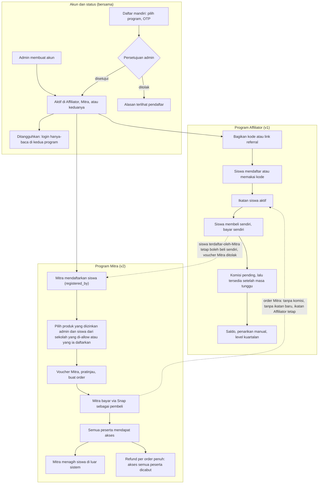

# Business Requirements Document (BRD)

## Fitur Mitra (Program Mitra, Affiliator v2)

| Item | Keterangan |
|---|---|
| Versi | 0.5 (Draft) |
| Tanggal | 9 November 2026 |
| Status | Draft hasil diskusi, untuk ditinjau sebelum TRD ditulis |
| Audiens | Tim internal (produk, engineering, operasional) |
| Platform | Aplikasi web ujian online dan marketplace (Backend Golang, Frontend Next.js) |
| Program terkait | Program Affiliator (affiliate klasik): `docs/specs/affiliate-program-brd.md` (v0.4) dan `docs/specs/affiliate-program.md` |
| Perubahan v0.1 | Dokumen awal. Memuat juga perubahan pada Program Affiliator yang diputuskan dalam diskusi yang sama (bagian 8.9) |
| Perubahan v0.2 | Koreksi dari pembacaan kode untuk TRD (`docs/specs/partner-program.md`): voucher Mitra tidak memakai `affiliator_only` (arti di v1 berbeda), penanda program di `affiliators.programs`. Voucher untuk siswa dan voucher untuk Mitra dibedakan di dashboard (BR-VCH-07, BR-VCH-08). Pengecekan ulang kepemilikan produk saat checkout (BR-BLI-09). Diagram alur (Lampiran D). Pertanyaan terbuka baru Q-08 sampai Q-10 |
| Perubahan v0.3 | Tidak ada pencabutan program (penangguhan akun cukup, BR-REG-06 dan BR-STS-04). Tidak ada aturan khusus untuk referral ke siswa sendiri (Q-10). Satuan kuota voucher Mitra dipilih admin per voucher, order atau siswa (BR-VCH-09). Q-08, Q-09, dan Q-10 terjawab |
| Perubahan v0.4 | Kredensial siswa yang didaftarkan Mitra mengikuti pola admin sekolah: kata sandi sementara ditampilkan sekali, siswa wajib menggantinya, Mitra boleh menerbitkan ulang hanya selama siswa belum mengganti (BR-SIS-04 sampai BR-SIS-06). Kolom daftar siswa Mitra ditetapkan (BR-SIS-03). Q-01 dan Q-02 terjawab |
| Perubahan v0.5 | Impor CSV siswa oleh Mitra masuk lingkup (BR-SIS-07). Satu produk per order dikonfirmasi. Tidak ada email persetujuan. Teks ketentuan diperbaiki untuk kedua program (Lampiran E, draf untuk ditinjau pemilik produk). Isi halaman ringkasan ditetapkan (FR-PRT-02). Semua pertanyaan terbuka terjawab |

Catatan penamaan: di UI program ini bernama **Mitra**, program lama bernama **Affiliator**. Di kode dan database Mitra memakai kata `partner`, sedangkan role akun tetap `affiliator` (sudah ada di `users`).

---

## Daftar Isi

1. Ringkasan Eksekutif
2. Latar Belakang dan Masalah
3. Tujuan Bisnis
4. Ruang Lingkup
5. Aktor dan Peran
6. Glosarium
7. Gambaran Proses Bisnis
8. Aturan Bisnis
9. Kebutuhan Fungsional
10. Parameter yang Diatur Admin
11. Kebutuhan Non-Fungsional
12. Asumsi
13. Risiko dan Mitigasi
14. Dependensi
15. Pertanyaan Terbuka
16. Lampiran

---

## 1. Ringkasan Eksekutif

**Mitra** adalah individu atau pihak yang mendaftarkan siswa ke platform dan membelikan produk untuk siswa tersebut dengan **voucher khusus Mitra**. Keuntungan Mitra adalah selisih harga: Mitra membayar harga setelah voucher lewat Midtrans Snap, lalu menagih siswa dengan harga yang ia tentukan sendiri di luar sistem. Platform tidak mencatat harga jual Mitra ke siswa dan tidak menangani penagihan itu.

Admin mengendalikan tiga hal: **siapa** yang menjadi Mitra, **sekolah mana** yang boleh dibelikan, dan **produk mana** yang boleh dibeli, serta **voucher** yang hanya bisa dilihat dan dipakai Mitra terpilih.

Mitra tidak mendapat komisi, saldo, level, atau pencairan. Satu akun dapat mengikuti Program Affiliator, Program Mitra, atau keduanya, ditentukan admin.

## 2. Latar Belakang dan Masalah

- Sebagian penjualan produk digital (ujian dan kursus) terjadi lewat perantara yang sudah mengenal siswa, misalnya pengelola kelas atau lembaga bimbingan, bukan lewat siswa yang membeli sendiri.
- Program Affiliator memberi imbalan komisi atas rekomendasi, tetapi tidak menyediakan cara bagi perantara untuk mendaftarkan siswa dan membelikan produk atas nama siswa.
- Tanpa saluran resmi, perantara memakai akun siswa bersama atau meminta admin mendaftarkan satu per satu. Admin tidak punya kontrol harga khusus perantara.

## 3. Tujuan Bisnis

1. Menyediakan saluran penjualan lewat perantara yang dikendalikan admin (siapa, sekolah, produk, voucher).
2. Memisahkan jelas dua model: imbalan komisi (Affiliator) dan selisih harga (Mitra), tanpa saling mengganggu.
3. Tidak menambah beban keuangan baru: tanpa saldo, tanpa pencairan, tanpa rekonsiliasi komisi.

Indikator keberhasilan (target angka belum ditetapkan): jumlah Mitra aktif, siswa yang didaftarkan lewat Mitra, order dan nilai penjualan lewat voucher Mitra, serta tingkat refund order Mitra.

## 4. Ruang Lingkup

### 4.1 Dalam lingkup

- Pendaftaran Mitra: mandiri (dengan persetujuan) dan dibuat admin.
- Satu akun di satu atau dua program, dikelola admin.
- Penugasan sekolah yang boleh dibelikan, oleh admin.
- Mitra mendaftarkan siswa ke platform.
- Mitra membeli produk `exam` dan `course` untuk siswa, satu atau banyak siswa.
- Akses produk per Mitra, diatur admin di form produk.
- Voucher khusus Mitra, dibuat lewat halaman promo yang sudah ada.
- Refund order Mitra dan pencabutan akses siswa.
- Dashboard Mitra: siswa, pembelian, voucher.
- Menu portal dua grup (Affiliator dan Mitra) dengan pesan per keadaan.
- Perubahan pada Program Affiliator: default pengaturan kosong, saklar yang butuh pengaturan wajib, batas pendaftar harian dihapus (bagian 8.9).

### 4.2 Di luar lingkup

- Produk fisik (`book`, `merchandise`, `medal`): butuh alamat dan ongkir. Ditunda.
- Komisi, saldo, level, dan pencairan untuk Mitra.
- Harga jual Mitra ke siswa, penagihan, dan verifikasi pembayaran siswa ke Mitra.
- Refund per siswa dalam satu order.
- Laporan per sekolah, per produk, tren bulanan, dan ekspor.
- Mengubah akun admin sekolah menjadi Mitra (alur promote).
- Pembuatan Mitra massal lewat CSV.
- Aturan voucher tambahan: tanggal mulai, minimal kuantitas, dan lingkup produk per voucher.
- Perubahan role akun menjadi nama lain. Role tetap `affiliator`.

## 5. Aktor dan Peran

| Aktor | Peran |
|---|---|
| Mitra | Mendaftarkan siswa, membelikan produk dengan voucher, membayar lewat Snap |
| Siswa | Penerima akses produk. Boleh tetap membeli sendiri |
| Super admin | Menyetujui Mitra, menugaskan sekolah, mengatur akses produk dan voucher, menangguhkan akun, mengatur saklar program |
| Affiliator | Peserta Program Affiliator. Akun yang sama dapat juga Mitra |
| Sistem | Memvalidasi aturan, memberi akses setelah lunas, mencabut akses saat refund |

## 6. Glosarium

| Istilah | Arti |
|---|---|
| Mitra | Peserta Program Mitra |
| Affiliator | Peserta Program Affiliator (komisi referral) |
| Sekolah yang di-allow | Daftar sekolah yang ditugaskan admin ke Mitra untuk keperluan pembelian |
| Siswa terdaftar-oleh-Mitra | Siswa yang akunnya didaftarkan Mitra itu sendiri |
| Voucher Mitra | Kode promo yang hanya terlihat dan bisa dipakai Mitra terpilih |
| Akses produk | Pengaturan per produk: tidak tampil (`none`), tampil untuk semua Mitra (`all`), atau tampil untuk Mitra terpilih (`selected`) |
| Akun nonaktif | Akun yang ditangguhkan: tetap bisa login tapi hanya-baca |

## 7. Gambaran Proses Bisnis

### 7.1 Alur end-to-end

1. Calon Mitra mendaftar di halaman registrasi, memilih program, menyelesaikan OTP email, lalu menunggu persetujuan. Atau admin membuat akun langsung.
2. Super admin menyetujui, menentukan program (Affiliator, Mitra, atau keduanya), dan menugaskan sekolah yang di-allow.
3. Admin mengatur akses produk (di form produk) dan membuat voucher Mitra (di halaman promo).
4. Mitra mendaftarkan siswa ke platform.
5. Mitra memilih produk dan siswa (dari sekolah yang di-allow atau yang ia daftarkan), memasukkan voucher, melihat pratinjau, lalu membayar lewat Snap.
6. Setelah lunas, setiap siswa peserta mendapat akses produk.
7. Mitra menagih siswa di luar sistem dengan harga yang ia tentukan.
8. Bila order di-refund, uang kembali ke Mitra dan akses semua peserta order dicabut.

### 7.2 Keadaan akun di portal

| Keadaan | Efek di menu Mitra |
|---|---|
| Terdaftar dan aktif | Semua submenu berfungsi |
| Belum terdaftar | Menu terlihat. Saat diklik: "belum terdaftar, hubungi admin jika ingin terdaftar" |
| Menunggu persetujuan | Menu terlihat. Pesan: pendaftaran menunggu persetujuan admin |
| Ditolak | Menu terlihat. Pesan berisi alasan penolakan |
| Akun nonaktif | Semua data terbaca, semua aksi tulis ditolak |
| Program Mitra mati | Hanya-baca dengan banner bahwa program sedang tidak aktif |

## 8. Aturan Bisnis

### 8.1 Registrasi dan Akun (BR-REG)

- **BR-REG-01** Pendaftaran mandiri memakai form dan OTP email yang sudah dipakai Program Affiliator (nama, email, nomor HP, kata sandi, persetujuan syarat). Ditambah satu pilihan program dengan keterangan masing-masing.
- **BR-REG-02** Satu teks ketentuan berlaku untuk kedua program, dengan bagian umum, bagian Affiliator, dan bagian Mitra (Lampiran E). Pendaftar menyetujui teks yang sama apa pun programnya.
- **BR-REG-03** Admin dapat membuat akun langsung dan memilih program. Akun yang dibuat admin tidak melewati persetujuan.
- **BR-REG-04** Email yang sudah terdaftar (siswa, admin, atau role lain) ditolak. Akun affiliator yang belum menyelesaikan OTP boleh melanjutkan OTP. Pesan penolakan tidak menyebutkan role akun yang ada.
- **BR-REG-05** Pendaftaran mandiri menunggu persetujuan super admin. Saat menyetujui, admin dapat mengubah program yang diminta atau memberi dua program. Menolak wajib disertai alasan, dan pendaftar melihat alasan itu.
- **BR-REG-06** Satu akun dapat ikut Program Affiliator, Program Mitra, atau keduanya. Admin dapat menambah program kapan saja. Program tidak dapat dicabut dari akun; untuk menghentikan akses, akun ditangguhkan (BR-STS-01).
- **BR-REG-07** Halaman registrasi hanya menampilkan program yang sedang aktif. Bila hanya satu aktif, hanya satu ditampilkan. Bila keduanya mati, halaman registrasi disembunyikan.
- **BR-REG-08** Mitra tidak diminta rekening bank.
- **BR-REG-09** Tidak ada batas jumlah pendaftar per hari.

### 8.2 Status Akun (BR-STS)

- **BR-STS-01** Penangguhan dilakukan dengan menonaktifkan akun (status pengguna). Akun nonaktif tetap bisa login tetapi hanya-baca di kedua program: tidak bisa mendaftarkan siswa, membeli, atau mengubah data.
- **BR-STS-02** Status pendaftaran (menunggu, ditolak) terpisah dari penangguhan. Hanya penangguhan yang membuat akun hanya-baca.
- **BR-STS-03** Saklar Program Mitra dimatikan: Mitra hanya-baca dan portal menampilkan banner. Saklar terpisah dari saklar Program Affiliator.
- **BR-STS-04** Penangguhan berlaku untuk seluruh akun, tidak per program. Karena program tidak dapat dicabut (BR-REG-06), penangguhan satu-satunya cara menghentikan akses. Pada akun yang ditangguhkan komisi baru dan ikatan baru Affiliator berhenti, dan Mitra tidak dapat membeli.

### 8.3 Siswa (BR-SIS)

- **BR-SIS-01** Mitra bebas mendaftarkan siswa ke platform, tanpa batas sekolah. Setiap siswa tercatat didaftarkan oleh Mitra tersebut.
- **BR-SIS-02** Siswa yang didaftarkan Mitra tetap boleh membeli sendiri.
- **BR-SIS-03** Mitra melihat daftar siswa dari sekolah yang di-allow dan siswa yang ia daftarkan. Kolom yang ditampilkan sama untuk keduanya: nama, username, sekolah, kelas, jenjang, status akun, dan penanda belum aktif (siswa belum mengganti kata sandi sementara). Email, nomor HP, tanggal lahir, alamat, dan nilai tidak ditampilkan.
- **BR-SIS-04** Mitra tidak dapat mengubah status siswa, mengatur kata sandi siswa, atau melihat kredensial siswa, kecuali kata sandi sementara pada pendaftaran (BR-SIS-05) dan penerbitan ulang yang diizinkan (BR-SIS-06).
- **BR-SIS-05** Saat Mitra mendaftarkan siswa, sistem membuat kata sandi sementara yang ditampilkan sekali kepada Mitra. Mitra menyerahkannya ke siswa, dan siswa wajib menggantinya saat login pertama. Mitra tidak dapat menentukan kata sandi sendiri.
- **BR-SIS-06** Mitra dapat menerbitkan ulang kata sandi sementara hanya untuk siswa yang ia daftarkan dan selama siswa belum mengganti kata sandinya. Setelah siswa mengganti, siswa memakai lupa kata sandi lewat email, atau meminta admin bila tidak punya email. Penerbitan ulang tercatat di audit log.
- **BR-SIS-07** Mitra dapat mendaftarkan siswa massal lewat impor CSV memakai mekanisme impor siswa yang sudah ada. Sekolah per baris opsional dan bebas (BR-SIS-01); kolom kata sandi tidak diizinkan (BR-SIS-05). Tiap baris diproses sendiri: baris yang gagal tidak menggagalkan baris lain. Laporan hasil memuat kata sandi sementara tiap siswa yang berhasil dan hanya dapat diunduh oleh Mitra yang mengimpor, lewat tautan berumur pendek.

### 8.4 Pembelian (BR-BLI)

- **BR-BLI-01** Mitra hanya dapat membeli produk `exam` dan `course`.
- **BR-BLI-02** Mitra hanya dapat membeli produk yang akses produknya mengizinkan Mitra tersebut (bagian 8.6). Aturan ini berlaku di tiga tempat: daftar produk, pembuatan dan pratinjau order, dan checkout.
- **BR-BLI-03** Mitra hanya dapat membelikan siswa dari sekolah yang di-allow atau siswa yang ia daftarkan sendiri. Siswa lain ditolak.
- **BR-BLI-04** Siswa yang sudah memiliki produk dikeluarkan dari order dan tidak ditagih. Pratinjau menampilkan siapa yang dikeluarkan.
- **BR-BLI-05** Mitra adalah pembeli dan membayar seluruh total (setelah voucher) lewat Snap. Harga jual ke siswa dan penagihannya di luar sistem dan tidak dicatat.
- **BR-BLI-06** Setelah lunas, setiap siswa peserta mendapat akses: registrasi ujian untuk `exam`, pendaftaran kelas untuk `course`.
- **BR-BLI-07** Mitra tanpa sekolah yang di-allow dan tanpa siswa yang ia daftarkan melihat pesan yang jelas di halaman pembelian, bukan halaman kosong.
- **BR-BLI-08** Order yang dibuat Mitra tidak dapat dibayar bila Mitra nonaktif.
- **BR-BLI-09** Saat checkout, kepemilikan produk oleh peserta diperiksa ulang. Bila ada peserta yang kini sudah memiliki produk (misalnya dibelikan pihak lain atau membeli sendiri sejak order dibuat), checkout ditolak dengan daftar siswa yang bersangkutan, sebelum pembayaran dibuat.

### 8.5 Voucher (BR-VCH)

- **BR-VCH-01** Voucher dibuat admin lewat halaman promo yang sudah ada, dengan opsi "khusus Mitra" dan pilihan Mitra. Pilihan kosong berarti semua Mitra.
- **BR-VCH-02** Voucher khusus Mitra tidak tampil di daftar promo publik dan ditolak untuk siapa pun selain Mitra terpilih, walaupun kodenya diketahui.
- **BR-VCH-03** Voucher divalidasi saat pratinjau, pembuatan order, dan checkout. Bila saat checkout voucher sudah kedaluwarsa, kuota habis, atau nilainya berubah, checkout ditolak sebelum pembayaran dibuat.
- **BR-VCH-04** Kuota `max_uses` tidak boleh terlampaui walau dua checkout terjadi bersamaan.
- **BR-VCH-05** Voucher dan akses produk keduanya harus mengizinkan. Voucher untuk Mitra pada produk yang tidak tampil untuk Mitra itu tidak dapat dipakai. Form promo memberi peringatan (bukan galat).
- **BR-VCH-06** Perilaku voucher publik dan voucher biasa tidak berubah.
- **BR-VCH-07** Dashboard membedakan dua jenis voucher. Menu Affiliator menampilkan promo **untuk dibagikan ke siswa** (promo khusus affiliator yang sudah ada, dipakai siswa di checkout dengan kodenya). Menu Mitra menampilkan voucher **untuk pembelian Mitra sendiri**. Keduanya tidak tercampur dalam satu daftar.
- **BR-VCH-09** Admin memilih satuan kuota saat membuat voucher Mitra: per order atau per siswa. Tidak ada nilai bawaan; satuan wajib dipilih. Per order: `max_uses` menghitung order dan diskon maksimum berlaku sekali untuk seluruh order (perilaku promo yang ada). Per siswa: `max_uses` menghitung kursi (order 50 siswa memakai 50 kuota) dan diskon maksimum berlaku per siswa. Minimum order tetap per order pada kedua satuan. Order yang melebihi sisa kuota ditolak seluruhnya dengan pesan berisi sisa kuota; tidak ada order parsial.
- **BR-VCH-08** Pembelian Mitra hanya menerima voucher Mitra. Promo publik, dan promo khusus affiliator yang dibagikan ke siswa, tidak dapat dipakai pada order Mitra. Sebaliknya siswa tidak dapat memakai voucher Mitra.

### 8.6 Akses Produk (BR-AKP)

- **BR-AKP-01** Admin mengatur akses produk di form produk: `none` (default), `all`, atau `selected` dengan daftar Mitra.
- **BR-AKP-02** Produk baru berstatus `none`.
- **BR-AKP-03** Produk yang disembunyikan atau Mitra yang dicabut dari daftar setelah order dibuat tetapi sebelum dibayar: checkout ditolak. Order yang sudah dibayar tidak terpengaruh.

### 8.7 Refund (BR-REF)

- **BR-REF-01** Refund selalu per order penuh. Tidak ada refund per siswa.
- **BR-REF-02** Uang kembali ke Mitra sebagai pembeli.
- **BR-REF-03** Refund mencabut akses semua peserta order itu (registrasi ujian dan pendaftaran kelas).

### 8.8 Hubungan dengan Program Affiliator (BR-HUB)

- **BR-HUB-01** Order Mitra tidak menghasilkan komisi dan tidak membuat atau memperpanjang ikatan Affiliator.
- **BR-HUB-02** Siswa yang terikat ke Affiliator tetap terikat. Pembelian lewat Mitra tidak mengubah ikatan dan tidak menghasilkan komisi bagi Affiliator tersebut.
- **BR-HUB-03** Dua program berjalan terpisah: saklar, pengaturan, dan menu masing-masing. Penangguhan akun memengaruhi keduanya (BR-STS-01).
- **BR-HUB-04** Menu portal terdiri dari grup Affiliator dan grup Mitra dengan submenu masing-masing, serta menu Akun yang tunggal. Grup yang belum diikuti tetap terlihat dan menampilkan pesan (bagian 7.2). Akun satu program langsung ke program itu setelah login, akun dua program ke halaman ringkasan.

### 8.9 Perubahan pada Program Affiliator (BR-AFF)

- **BR-AFF-01** Semua pengaturan Program Affiliator berawal kosong. Tidak ada nilai bawaan tersembunyi (komisi per kategori, ambang naik dan bertahan, masa tunggu, masa ikatan, masa cookie, minimal payout, hari evaluasi, tanggal peluncuran).
- **BR-AFF-02** Saklar Program Affiliator tidak dapat dinyalakan sebelum pengaturan wajib terisi: tanggal peluncuran, masa cookie, masa ikatan, masa tunggu digital dan fisik, minimal payout, dan hari evaluasi. Halaman menampilkan pengaturan yang belum terisi.
- **BR-AFF-03** Komisi dan ambang boleh kosong. Bila komisi kosong saat menyalakan, halaman menampilkan peringatan non-blokir: tidak ada komisi yang akan dibuat.
- **BR-AFF-04** Pemeriksaan hanya berlaku saat menyalakan saklar. Program yang sudah menyala tidak dihentikan.
- **BR-AFF-05** Batas pendaftar harian dihapus.

## 9. Kebutuhan Fungsional

### 9.1 Registrasi dan akun (FR-REG)

- FR-REG-01 Halaman registrasi dengan pilihan program dan keterangan. Status program publik per program.
- FR-REG-02 Admin membuat akun Mitra, menyetujui atau menolak (dengan alasan), mengubah program saat persetujuan, dan menambah program ke akun yang sudah ada.
- FR-REG-03 Admin mengatur sekolah yang di-allow per Mitra, dengan pemilih yang dapat dicari.
- FR-REG-04 Admin menonaktifkan atau mengaktifkan kembali akun.

### 9.2 Siswa dan pembelian (FR-BLI)

- FR-BLI-01 Mitra mendaftarkan siswa, melihat daftar siswa, dan menerbitkan ulang kata sandi sementara siswa yang ia daftarkan (BR-SIS).
- FR-BLI-02 Mitra memilih produk dan siswa, memasukkan voucher, melihat pratinjau (jumlah ditagih, siswa yang dikeluarkan, diskon, total), lalu membayar lewat Snap.
- FR-BLI-03 Daftar pembelian Mitra dengan status order.
- FR-BLI-04 Daftar voucher yang tersedia bagi Mitra.

### 9.3 Pengaturan admin (FR-SET)

- FR-SET-01 Form produk: akses produk (`none`/`all`/`selected`) dengan pemilih Mitra.
- FR-SET-02 Halaman promo: opsi "khusus Mitra", pilihan Mitra, dan peringatan BR-VCH-05.
- FR-SET-03 Saklar Program Mitra, terpisah dari Program Affiliator.
- FR-SET-04 Pengaturan Program Affiliator: kolom kosong apa adanya, daftar pengaturan wajib yang belum terisi, dan peringatan komisi kosong.

### 9.4 Portal (FR-PRT)

- FR-PRT-01 Menu dua grup dan pesan per keadaan (bagian 7.2).
- FR-PRT-02 Halaman ringkasan untuk akun dua program: dua kartu, satu per program. Kartu Affiliator menampilkan status program, saldo tersedia, dan jumlah siswa terikat. Kartu Mitra menampilkan status program, jumlah siswa yang didaftarkan, dan jumlah order lunas. Program yang belum diikuti, menunggu, atau ditolak menampilkan pesan keadaannya (bagian 7.2) sebagai ganti angka. Tiap kartu menautkan ke dashboard programnya.

## 10. Parameter yang Diatur Admin

| Parameter | Tempat | Default |
|---|---|---|
| Saklar Program Mitra | Pengaturan sistem | Mati |
| Program per akun | Manajemen affiliator | Sesuai persetujuan |
| Sekolah yang di-allow | Manajemen affiliator | Kosong |
| Akses produk | Form produk | `none` |
| Voucher khusus Mitra dan Mitra terpilih | Halaman promo | Tidak khusus Mitra |

Program Mitra tidak punya parameter komisi, level, atau pencairan.

## 11. Kebutuhan Non-Fungsional

- **NFR-01 Keamanan.** Setiap pembatasan (program, sekolah, produk, voucher, status akun) ditegakkan di server, bukan hanya di tampilan.
- **NFR-02 Performa.** Daftar siswa Mitra (sekolah yang di-allow atau didaftarkan olehnya) harus tetap cepat pada data besar. Perlu `EXPLAIN` pada data seukuran produksi sebelum rilis.
- **NFR-03 Konsistensi.** Pembuatan order Mitra dan checkout aman dari permintaan ganda dan dari kuota voucher yang terlampaui.
- **NFR-04 Audit.** Persetujuan, penolakan, perubahan program, penugasan sekolah, perubahan akses produk, dan penangguhan tercatat di audit log yang ada.
- **NFR-05 Rilis.** Perubahan Program Affiliator yang sudah di production dirilis bertahap (lihat Lampiran B).

## 12. Asumsi

- A-01 Program Affiliator belum berjalan di production dan hanya memuat data uji pemilik produk.
- A-02 Satu order untuk satu produk dan satu atau banyak siswa. Mitra membuat order terpisah untuk produk berbeda (dikonfirmasi).
- A-03 Impor CSV siswa oleh Mitra memakai mekanisme pendaftaran siswa yang sudah ada (tunggal dan massal), dengan pengecualian sekolah (BR-SIS-01) dan kata sandi (BR-SIS-05) (dikonfirmasi, BR-SIS-07).
- A-04 Mitra tidak membatasi jumlah siswa yang dapat didaftarkan atau dibelikan per hari.
- A-05 Harga produk untuk Mitra adalah harga produk yang berlaku, dikurangi voucher bila ada.
- A-06 Satuan kuota voucher Mitra tidak punya nilai bawaan; admin memilihnya (BR-VCH-09). Voucher non-Mitra tetap per order.

## 13. Risiko dan Mitigasi

| Risiko | Mitigasi |
|---|---|
| Voucher bocor ke pihak lain | Pembatasan di validasi, bukan hanya di daftar (BR-VCH-02, BR-VCH-03) |
| Mitra menjual di bawah harga atau menyalahgunakan akun siswa | Di luar kendali sistem. Admin dapat menangguhkan akun (BR-STS-01) |
| Akses siswa tidak tercabut saat refund | Pendaftaran kelas perlu terhubung ke order peserta agar refund mencabutnya (BR-REF-03) |
| Mitra dan Affiliator saling mengganggu | Aturan pemisahan di BR-HUB-01 sampai BR-HUB-03, dan uji bahwa order Mitra tidak membuat komisi |
| Pembatasan hanya di menu | NFR-01 |
| Akun Mitra terbaca oleh job dan daftar Program Affiliator | Job dan daftar Program Affiliator harus menyaring akun yang tidak ikut program itu |
| Mitra tanpa sekolah tidak bisa membeli siapa pun | BR-BLI-07 |
| Pembelian-sendiri lewat kode referral sendiri tidak merugikan pelaku bila komisi mendekati harga (komisi nominal tetap dibatasi hanya sampai harga item) atau bila pembayaran ditarik kembali setelah masa tunggu komisi | Admin menjaga nilai komisi nominal jauh di bawah harga produk. Penarikan pembayaran bukan risiko baru, sudah ada pada Program Affiliator |

## 14. Dependensi

- Midtrans Snap untuk pembayaran (alur pembayaran yang sudah ada).
- Pendaftaran siswa, order peserta, dan alur refund yang sudah ada.
- Halaman promo dan form produk yang sudah ada.
- Form registrasi, OTP, dan persetujuan Program Affiliator yang sudah ada.

## 15. Pertanyaan Terbuka

- **Q-01** (Terjawab) Kolom siswa yang terlihat oleh Mitra ditetapkan di BR-SIS-03.
- **Q-02** (Terjawab) Kata sandi sementara ditampilkan sekali, siswa wajib mengganti, Mitra dapat menerbitkan ulang hanya selama belum diganti (BR-SIS-05, BR-SIS-06).
- **Q-03** (Terjawab) Impor CSV siswa oleh Mitra termasuk lingkup (BR-SIS-07).
- **Q-04** (Terjawab) Satu order satu produk cukup (A-02).
- **Q-05** (Terjawab) Tidak ada email saat pendaftaran disetujui atau ditolak. Pendaftar melihat statusnya di portal (bagian 7.2).
- **Q-06** (Terjawab) Teks ketentuan diperbaiki untuk kedua program (Lampiran E). Draf perlu ditinjau pemilik produk sebelum dipakai.
- **Q-07** (Terjawab) Isi halaman ringkasan ditetapkan di FR-PRT-02.

Tidak ada pertanyaan terbuka yang tersisa pada versi ini.
- **Q-08** (Terjawab) Pencabutan program tidak ada. Status akun (penangguhan) cukup; lihat BR-REG-06 dan BR-STS-04. Perlakuan saldo akun yang ditangguhkan tetap mengikuti kebijakan Program Affiliator yang berlaku (saldo tercatat, penarikan hanya untuk status aktif).
- **Q-09** (Terjawab) Satuan kuota voucher Mitra dipilih admin per voucher, order atau siswa (BR-VCH-09).
- **Q-10** (Terjawab) Tidak ada aturan khusus untuk akun dua program yang memakai kode referral sendiri pada siswa yang ia daftarkan. Komisi selalu lebih kecil dari harga yang dibayar, jadi pembelian-sendiri merugikan pelakunya. Risiko sisa dicatat di bagian 13.

## 16. Lampiran

### Lampiran A. Catatan untuk TRD

- Tidak ada tabel baru. Kolom baru (4): `users.registered_by`, `affiliators.programs` (JSONB: program yang diikuti dan `school_ids` Mitra; NULL = Affiliator saja), `product.partner_access` (JSONB: `none`/`all`/`selected` dan daftar id), `promo_code.partner` (JSONB: `ids` Mitra terpilih dan `quota_unit` `order`/`student`; NULL = bukan voucher Mitra, `ids` kosong = semua Mitra; berdiri sendiri, tidak memakai `promo_code.affiliator_only` yang artinya berbeda di Program Affiliator). Ditambah indeks parsial `users.registered_by`.
- Akun Mitra memakai baris `affiliators` yang sudah ada. `referral_code` dan `bank_account` sudah boleh kosong.
- Perubahan Program Affiliator memakai migrasi baru (nomor berikutnya, kemungkinan `0072`): pengaturan wajib menjadi nullable tanpa default, kolom `daily_registration_cap` dihapus.
- Default tersembunyi di kode juga dihapus: `affiliateDefaultCommissionRule`, `affiliateDefaultRiseThreshold`, dan `defaultAffiliateSettings()`.
- Fan-out pendaftaran kelas di outbox harus mengisi `order_id` di tiap sesi peserta agar refund mencabutnya. Validasi ulang voucher dipindah ke dalam `Checkout`, dan `IncrementPromoUsesTx` menerima jumlah pemakaian (1 per order atau jumlah kursi) dengan batas `used_count + n <= max_uses`.
- Login role `affiliator` perlu mengizinkan akun nonaktif dengan guard tulis di semua rute Program Affiliator dan Mitra.

### Lampiran B. Rencana rilis

Penghapusan kolom `daily_registration_cap` dilakukan dua rilis: rilis pertama kode berhenti membaca kolom itu, rilis kedua migrasi menghapusnya. Alasannya, migrasi berjalan saat API start dan pod lama masih membaca kolom itu selama deploy bertahap.

### Lampiran D. Diagram alur ringkas

Alur Affiliator (komisi referral) dan Mitra (selisih harga lewat voucher), dengan titik temu antar program.

Titik temu yang diperiksa untuk konflik: (1) status akun, (2) hook order lunas (komisi dan ikatan), (3) validasi promo, (4) refund, (5) data siswa (`registered_by` dan ikatan), (6) menu dan gerbang. Hasil pemeriksaan ada di Pertanyaan Terbuka (Q-08 sampai Q-10) dan di TRD.

### Lampiran C. Log Keputusan (diskusi 9 November 2026)

| Keputusan | Isi |
|---|---|
| Penamaan | Program Mitra (v2) dan Program Affiliator (v1). Kode memakai `partner`. Role akun tetap `affiliator` |
| Model | Selisih harga lewat voucher, tanpa komisi/saldo/pencairan. Harga jual dan penagihan di luar sistem |
| Pendaftaran siswa | Bebas, tanpa batas sekolah |
| Pembelian | Sekolah yang di-allow admin dan siswa yang didaftarkan sendiri. Hanya `exam` dan `course` |
| Siswa | Boleh tetap membeli sendiri |
| Voucher | Halaman promo yang sudah ada. Khusus Mitra terpilih |
| Akses produk | Tiga keadaan, default tidak tampil |
| Refund | Per order penuh, uang ke Mitra, akses semua peserta dicabut |
| Komisi | Order Mitra tidak menghasilkan komisi. Siswa tetap terikat ke Affiliator |
| Akun di dua program | Boleh. Admin yang menentukan |
| Penangguhan | Lewat status pengguna, login hanya-baca, memengaruhi kedua program |
| Pendaftaran | Form yang ada ditambah pilihan program. Email yang sudah ada ditolak. Batas harian dihapus |
| Menu | Dua grup, grup yang belum diikuti tetap terlihat dengan pesan per keadaan |
| Default Program Affiliator | Kosong. Saklar butuh pengaturan wajib terisi |
| Database | Tanpa tabel baru. 4 kolom baru dan satu indeks |
| Voucher (v0.2) | Mitra hanya memakai voucher Mitra. Dashboard membedakan voucher untuk dibagikan ke siswa (Affiliator) dan voucher untuk pembelian Mitra sendiri |
| Migrasi (v0.2) | Nomor `0072` dan `0073` terverifikasi bebas. Runner migrasi menjalankan tiap file dalam transaksi, jadi indeks dibuat tanpa `CONCURRENTLY` |
| Pencabutan program | Tidak ada. Program hanya ditambah; penangguhan akun menghentikan akses (Q-08) |
| Satuan kuota voucher | Dipilih admin per voucher Mitra: per order atau per siswa. Tanpa nilai bawaan (Q-09) |
| Kredensial siswa | Kata sandi sementara sekali tampil, wajib diganti siswa. Mitra boleh menerbitkan ulang hanya selama siswa belum mengganti, supaya tidak ada pengambilalihan akun (Q-02) |
| Data siswa di daftar Mitra | Nama, username, sekolah, kelas, jenjang, status, penanda belum aktif. Tanpa email, HP, tanggal lahir, alamat, nilai (Q-01) |
| Impor CSV siswa | Masuk lingkup. Sekolah opsional dan bebas, tanpa kolom kata sandi, laporan hasil hanya untuk pengimpor (Q-03) |
| Order | Satu produk per order (Q-04) |
| Email persetujuan | Tidak ada (Q-05) |
| Teks ketentuan | Satu teks untuk dua program, diperbaiki. Draf di Lampiran E, perlu ditinjau pemilik produk (Q-06) |
| Halaman ringkasan | Dua kartu, satu per program (Q-07) |

### Lampiran E. Draf teks ketentuan program (untuk ditinjau)

Draf pengganti `aff_terms_1` sampai `aff_terms_8` (id dan en). Ini draf kebijakan, bukan nasihat hukum; pemilik produk perlu meninjau dan menyetujui kata-katanya sebelum dirilis. Versi teks naik dari `2026-10` ke `2026-11`.

Judul: **Ketentuan Program Affiliator dan Mitra**

*Umum (berlaku untuk keduanya)*
1. Pendaftaran ditinjau admin. Program yang kamu pilih baru aktif setelah pendaftaran disetujui, dan admin dapat menyesuaikan atau menambah program pada akunmu.
2. Admin dapat menangguhkan akunmu bila ada pelanggaran ketentuan. Selama ditangguhkan, akunmu hanya dapat dibaca di kedua program: kamu tidak dapat melakukan tindakan baru, tidak mendapat komisi baru, dan tidak dapat membeli atau menarik saldo.

*Program Affiliator*
3. Kode dan tautan referral baru aktif setelah pendaftaran disetujui. Siswa yang mendaftar atau membeli dengan kodemu terikat kepadamu untuk periode tertentu; pembelian lunas dapat memperpanjang ikatan.
4. Komisi dihitung per item pada pembelian lunas siswa yang terikat, sesuai persentase level dan kategori produk saat pembelian. Pembelian atas akun milikmu sendiri tidak menghasilkan komisi.
5. Komisi baru dapat dicairkan setelah masa tunggu refund. Refund membatalkan atau mengurangi komisi terkait, dan saldo dapat bernilai negatif sementara. Penarikan dilakukan manual oleh admin ke rekening yang kamu daftarkan, dengan batas minimum penarikan.
6. Penyalahgunaan, misalnya memakai kodemu sendiri untuk membeli atau menyalahgunakan tautan, dapat berujung penangguhan atau penonaktifan; penonaktifan membatalkan komisi yang masih menunggu. Kamu hanya melihat nama depan dan inisial siswa binaan; data pribadi siswa tidak dibagikan.

*Program Mitra*
7. Kamu dapat mendaftarkan siswa ke platform dan membelikan produk untuk siswa dari sekolah yang ditetapkan admin atau siswa yang kamu daftarkan sendiri. Kamu hanya dapat membeli produk yang ditetapkan admin untukmu.
8. Kamu membayar order sebagai pembeli, setelah dikurangi voucher Mitra bila ada. Harga jual kepada siswa dan penagihannya kamu tentukan dan menjadi tanggung jawabmu; platform tidak mencatat atau menjamin pembayaran siswa kepadamu.
9. Voucher Mitra hanya untuk pembelianmu sendiri dan tidak boleh dibagikan atau dipakai pihak lain. Pembelian lewat Mitra tidak menghasilkan komisi Affiliator.
10. Refund dilakukan per order penuh dan dikembalikan kepadamu sebagai pembeli; akses semua siswa pada order itu dicabut.
11. Kata sandi sementara siswa yang kamu daftarkan hanya untuk diserahkan kepada siswa. Siswa wajib menggantinya, dan setelah itu kamu tidak dapat mengakses akun siswa. Data siswa hanya untuk keperluan pembelian dan tidak boleh dibagikan.
| Referral ke siswa sendiri | Tanpa aturan khusus, karena komisi selalu lebih kecil dari harga (Q-10) |
| Migrasi | Migrasi baru (program sudah di production), dua rilis untuk penghapusan kolom |
